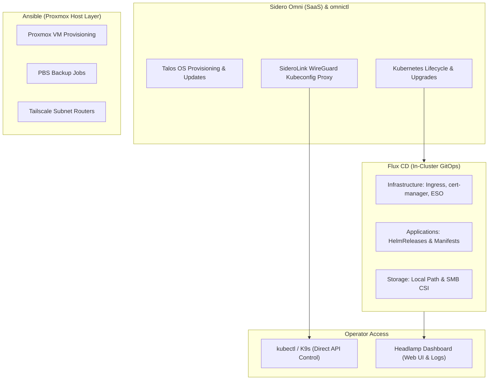

# Kubernetes Migration Plan: Multi-Home Single-Node Clusters with Talos Linux and Sidero Omni

## Table Of Contents

- [Purpose](#purpose)
- [Current Environment Summary](#current-environment-summary)
- [Target Architecture](#target-architecture)
  - [Cluster Topology: Independent Single-Node Clusters](#cluster-topology-independent-single-node-clusters)
  - [Management Layer: Sidero Omni SaaS & omnictl](#management-layer-sidero-omni-saas--omnictl)
  - [Dashboard & Workload Visibility: Headlamp](#dashboard--workload-visibility-headlamp)
  - [GitOps Engine: Flux CD](#gitops-engine-flux-cd)
  - [Operational Tooling Separation](#operational-tooling-separation)
- [Networking And Ingress](#networking-and-ingress)
  - [Omni Default CNI (Flannel) & Network Policies](#omni-default-cni-flannel--network-policies)
  - [Ingress Controller, TLS, and DNS Automation](#ingress-controller-tls-and-dns-automation)
- [Authentication And Authorization](#authentication-and-authorization)
  - [Omni Control Plane Access](#omni-control-plane-access)
  - [Kubernetes API Access](#kubernetes-api-access)
  - [Headlamp Dashboard Access](#headlamp-dashboard-access)
- [Secrets Management](#secrets-management)
- [Storage And Backup](#storage-and-backup)
  - [Storage Classes](#storage-classes)
  - [Backup Strategy & Disaster Recovery](#backup-strategy--disaster-recovery)
- [GitOps Repository Layout](#gitops-repository-layout)
- [Migration Sequence](#migration-sequence)
  - [Phase 0: Prerequisites & Omni Account Setup](#phase-0-prerequisites--omni-account-setup)
  - [Phase 1: Home 1 Cluster Bootstrap & Platform Foundation](#phase-1-home-1-cluster-bootstrap--platform-foundation)
  - [Phase 2: Home 2 Cluster Bootstrap & Multi-Cluster GitOps](#phase-2-home-2-cluster-bootstrap--multi-cluster-gitops)
  - [Phase 3: Lower-Risk Application Migration](#phase-3-lower-risk-application-migration)
  - [Phase 4: Stateful & Media Workloads](#phase-4-stateful--media-workloads)
  - [Phase 5: Edge & Hardware-Bound Workloads](#phase-5-edge--hardware-bound-workloads)
- [Workloads Remaining Outside Kubernetes Initially](#workloads-remaining-outside-kubernetes-initially)
- [Validation And Exit Criteria](#validation-and-exit-criteria)
- [Confirmed Decisions & Remaining Implementation Choices](#confirmed-decisions--remaining-implementation-choices)

---

## Purpose

Migrate suitable homelab Docker Compose workloads running across two separate physical homes to **Talos Linux Kubernetes**, centrally managed through the **Sidero Omni SaaS platform**.

The architecture establishes **one single-node cluster in each home**, providing complete failure isolation and zero cross-WAN dependencies, while maintaining a unified management and deployment model:
- **Sidero Omni SaaS** provides the control and management plane for Talos machine lifecycle, OS upgrades, automated Kubernetes version management, and secure remote SideroLink tunnels.
- **`omnictl`** serves as the administrative CLI for machine registration, cluster templates, and credential provisioning.
- **`kubectl`** and **K9s** serve as the day-to-day Kubernetes management tools, connecting over Omni's secure WireGuard proxy without exposing API ports to the public internet.
- **Headlamp** acts as the user-friendly, in-cluster Kubernetes dashboard for application monitoring, logs, pod inspection, and resource visibility.
- **Flux CD** reconciles declarative infrastructure and application manifests from this monorepo, keeping both clusters configured independently from a shared Git foundation.
- **Ansible** continues to manage underlying Proxmox virtual machines, host hardware passthrough, NAS configuration, and Tailscale routing.

---

## Current Environment Summary

- **Physical Sites**:
  - **Home 1 (`pve-1`)**: Hosts the primary VM infrastructure including `Docker-1` (Traefik, Plex companion apps, Gitea, WebUI, utilities), `DNS-1` (AdGuard Home), `Plex-1` (media server with GPU), `Gaming-1`, and the dedicated NAS host (`pve-nas`).
  - **Home 2 (`pve-2`)**: Hosts secondary VM infrastructure including `Docker-2` (Traefik, Home Assistant, PDF, utilities) and `DNS-2` (AdGuard Home).
- **Inter-Site Networking**: Tailscale site-to-site routers bridge the subnets between homes.
- **Application State**: Workloads currently use host-local `/Apps/...` bind mounts.
- **Shared Storage**: Media is shared from the Home 1 NAS SMB share at `//192.168.10.12/Medias`.
- **Ingress & TLS**: Traefik currently acts as reverse proxy, handling Let's Encrypt DNS-01 challenges via Azure DNS.
- **Identity & Secrets**: Microsoft Entra ID provides identity, and Azure Key Vault holds sensitive configuration.

---

## Target Architecture

### Cluster Topology: Independent Single-Node Clusters

Rather than stretching a single Kubernetes cluster across two residential WAN links (which introduces etcd latency spikes, quorum loss hazards, and split-brain failures when the inter-site tunnel drops), the environment will run **two independent single-node clusters**:

```text
               +-------------------------------------------+
               |             Sidero Omni (SaaS)            |
               |       https://omni.siderolabs.com         |
               +---------------------+---------------------+
                                     |
                SideroLink WireGuard | Encrypted Tunnels
                                     |
               +---------------------+---------------------+
               |                                           |
               v                                           v
    +----------------------+                   +----------------------+
    |    Home 1 (pve-1)    |                   |    Home 2 (pve-2)    |
    |  Cluster: k8s-talos-1|                   |  Cluster: k8s-talos-2|
    |                      |                   |                      |
    |  +----------------+  |                   |  +----------------+  |
    |  | Node: talos-1  |  |                   |  | Node: talos-2  |  |
    |  | (Control Plane)|  |                   |  | (Control Plane)|  |
    |  +----------------+  |                   |  +----------------+  |
    |  - Omni CNI (Flannel)|                   |  - Omni CNI (Flannel)|
    |  - Traefik Ingress   |                   |  - Traefik Ingress   |
    |  - Flux CD           |                   |  - Flux CD           |
    |  - Headlamp          |                   |  - Headlamp          |
    |  - Local Storage     |                   |  - Local Storage     |
    |  - SMB CSI (NAS)     |                   |  - Local Services    |
    +----------------------+                   +----------------------+
               ^                                           ^
               |                                           |
               +================= Tailscale ===============+
                                Site-to-Site
```

| Node Name | Cluster Name | Location / Host | Machine Role | Scheduling | Primary Workload Scope |
| --- | --- | --- | --- | --- | --- |
| `talos-1` | `k8s-talos-1` | Home 1 (`pve-1` VM) | Talos Control Plane | `allowSchedulingOnControlPlanes: true` | Web apps, dev tools, media companion stack, monitoring |
| `talos-2` | `k8s-talos-2` | Home 2 (`pve-2` VM) | Talos Control Plane | `allowSchedulingOnControlPlanes: true` | Local home services, remote utility apps, secondary tooling |

#### Benefits of Single-Node Clusters in Each Home:
1. **Zero Cross-Site Failure Coupling**: If Home 1 loses power or internet, Home 2's cluster continues running unaffected (and vice versa). Local home automation and internal DNS remain fully operational.
2. **Simplified Storage & Scheduling**: Local volumes have zero failover ambiguity. There is no need for complex distributed block storage (Ceph/Longhorn) that requires 3+ nodes and high-bandwidth interconnects.
3. **No Control Plane / Worker Split Overhead**: In small footprint setups, dedicating separate VMs for control plane and workers wastes CPU and RAM on redundant kernel and etcd overhead. Single-node Talos with schedulable control plane runs workloads efficiently on 100% of the allocated resources.
4. **Independent Maintenance Windows**: Either home cluster can be rebooted, upgraded, or reconfigured without impacting the other site.

---

### Management Layer: Sidero Omni SaaS & omnictl

Sidero Omni is the cloud-hosted management platform purpose-built for Talos Linux:

- **Machine Bootstrapping**: Talos VMs boot using an Omni-generated boot media (ISO or kernel image) configured with the Omni account registration URL and secure token.
- **SideroLink WireGuard Mesh**: Each Talos machine establishes an encrypted, outbound-only WireGuard tunnel to Omni. This eliminates the need to expose Kubernetes API ports or Talos API ports to the public internet or configure port forwarding on residential routers.
- **Declarative Cluster Templates**: Clusters are defined and managed declaratively via Omni Cluster Templates (`omni.siderolabs.io/v1alpha1`).
- **Control Plane Schedulability**: For single-node clusters, the cluster template applies an inline machine config patch:
  ```yaml
  patches:
    - name: allow-controlplane-workloads
      inline:
        cluster:
          allowSchedulingOnControlPlane: true
  ```
- **CLI Management (`omnictl`)**:
  - `omnictl cluster template sync -f ...`: Applies declarative cluster specifications.
  - `omnictl cluster upgrade ...`: Executes zero-downtime or controlled OS and Kubernetes version upgrades.
  - `omnictl kubeconfig`: Generates a kubeconfig routed securely through the Omni SideroLink proxy to the target cluster.
  - `omnictl talosconfig`: Generates client configuration for direct Talos OS API operations.

---

### Dashboard & Workload Visibility: Headlamp

**Headlamp** is the Kubernetes web UI dashboard for developers and administrators:
- **Deployment**: Deployed as an in-cluster workload via Flux HelmRelease in each cluster (or configured to view both clusters from a single UI).
- **Authentication**: Secured with Microsoft Entra ID OIDC (either natively or via an `oauth2-proxy` front end), ensuring single sign-on consistency with existing homelab tools.
- **Role**: Headlamp provides read/write visualization for Pods, Deployments, Persistent Volumes, CronJobs, Helm releases, events, and container logs.
- **Separation of Concerns**:
  - **Omni SaaS UI**: Used for node hardware status, Talos OS configuration, cluster bootstrapping, and Talos upgrades.
  - **Headlamp UI**: Used for day-to-day Kubernetes workload monitoring, log viewing, and pod inspection.
  - **Flux CD**: Serves as the sole authoritative deployment engine—changes are made via Git commits, not manual UI clicks.

---

### GitOps Engine: Flux CD

Flux CD runs inside each cluster, continuously reconciling desired state from the Git repository:

- **Monorepo Structure**: A unified repository root manages both clusters, sharing common application definitions and infrastructure operators while maintaining separate cluster overlays (`clusters/k8s-talos-1` and `clusters/k8s-talos-2`).
- **Independent State**: Each cluster has its own `Kustomization` and `HelmRelease` manifests, allowing cluster-specific sizing, volume mappings, and environment variables.
- **Automated Upgrades**: Flux works seamlessly with Renovate Bot to detect and open PRs for Helm chart and container image updates.
- **Continuous Validation**: GitHub Actions runs `kubeconform` and Kustomize dry-runs on pull requests before merging to `main`.

---

### Operational Tooling Separation

To ensure clean administrative boundaries, each tool is assigned a distinct responsibility:



---

## Networking And Ingress

### Omni Default CNI (Flannel) & Network Policies

The clusters use the **out-of-the-box networking default** provided by Talos Linux and Sidero Omni, with native network policy enforcement enabled:
- **Flannel CNI**: Deployed and configured automatically on boot by Talos. Extremely lightweight (~30–50 MB RAM per node compared to 500 MB–1 GB+ for heavy eBPF CNI stacks), saving valuable system resources.
- **Native Kube-Proxy**: Standard Kubernetes `kube-proxy` is retained and managed natively by Talos without manual intervention.
- **Single-Node Simplicity**: Since each cluster is a single node (`talos-1` and `talos-2`), all pod-to-pod routing is host-local. Flannel manages pod IPAM seamlessly with no overlay complexity.
- **Outbound IP Firewalling & Network Policies (`kubeNetworkPoliciesEnabled: true`)**:
  By enabling the built-in network policy controller in Talos machine configuration, standard Kubernetes `NetworkPolicy` resources are fully enforced for both **Ingress** and **Egress (outbound)**:
  - **Outbound LAN Isolation**: Block pods from accessing internal home LAN subnets (e.g. `192.168.0.0/16`, `10.0.0.0/8`, `172.16.0.0/12`) while still allowing outbound internet traffic via CIDR `ipBlock` rules.
  - **Port-Based Outbound Restrictions**: Restrict pod egress strictly to authorized ports (e.g., DNS on UDP/TCP `53` and HTTPS on TCP `443`).
  - **Namespace & Database Isolation**: Completely block database or internal backend pods from initiating outbound connections to the internet or outside their namespace.
  - **Zero Third-Party Agent Overhead**: Handled by the native Linux kernel packet filtering without requiring Cilium, Calico, or custom kernel modules.

#### Example Outbound Firewall Policy (Block LAN, Allow Internet):

```yaml
apiVersion: networking.k8s.io/v1
kind: NetworkPolicy
metadata:
  name: isolate-from-lan
  namespace: default
spec:
  podSelector:
    matchLabels:
      security: restricted-egress
  policyTypes:
    - Egress
  egress:
    # 1. Allow DNS queries to cluster CoreDNS
    - to:
        - namespaceSelector: {}
          podSelector:
            matchLabels:
              k8s-app: kube-dns
      ports:
        - protocol: UDP
          port: 53
        - protocol: TCP
          port: 53
    # 2. Allow outbound internet traffic, while blocking internal LANs
    - to:
        - ipBlock:
            cidr: 0.0.0.0/0
            except:
              - 192.168.0.0/16     # Home LANs
              - 10.0.0.0/8          # Internal networks / Pod CIDRs
              - 172.16.0.0/12       # Docker / private subnets
      ports:
        - protocol: TCP
          port: 443
        - protocol: TCP
          port: 80
```

### Ingress Controller, TLS, and DNS Automation

Rather than running complex multi-node load balancers or BGP routers, traffic entry relies on the dedicated node IP and **Traefik Ingress Controller**:

```text
       Clients (LAN / Tailscale)
                   |
                   | HTTP :80 / HTTPS :443
                   v
       Node IP (talos-1 / talos-2)
                   |
                   v (hostPort 80/443)
       +-------------------------------+
       |   Traefik Ingress Controller  |
       |     (Deployed via Flux)       |
       +---------------+---------------+
                       |
        +--------------+--------------+
        |                             |
        v                             v
  HTTP Services                 HTTP Services
 (Homepage, PDF, WebUI)       (Gitea, Headlamp, etc.)
```

| Component | Responsibility | Implementation Details |
| --- | --- | --- |
| **Traefik Ingress** | External HTTP(S) entry point & reverse proxy | Deployed via official Traefik Helm chart through Flux. Binds ports `80` and `443` directly on the host using `hostPort` (or `hostNetwork: true`), matching your existing Docker setup. |
| **Routing Model** | Hostname & path routing | Standard Kubernetes `Ingress` resources and Traefik `IngressRoute` CRDs. |
| **cert-manager** | Automated TLS certificates | Interacts with Let's Encrypt using DNS-01 ACME challenges against Azure DNS. |
| **Azure DNS Solver** | ACME challenge solver | Resolves wildcard and hostname challenges against your existing Azure DNS domains. |
| **external-dns** (Phase 2+) | DNS record synchronization | Automates creation of AdGuard Home / Azure DNS records pointing to the node IP. |

**No External LoadBalancer Required**: Because each cluster is hosted on a single VM with a fixed LAN IP, incoming traffic reaches the node directly. MetalLB, L2 announcements, and floating VIPs are eliminated entirely.

Traffic routes internally and externally via HTTPS. Certificates are securely stored in Kubernetes `Secret` resources and automatically rotated.

---

## Authentication And Authorization

### Omni Control Plane Access
- Administrative access to Omni SaaS is protected by MFA and single-sign-on.
- `omnictl` uses an encrypted API token to interface with the Omni management API.

### Kubernetes API Access
- **Through Omni SideroLink Proxy**:
  - Administrators execute `omnictl kubeconfig -c k8s-talos-1` or `omnictl kubeconfig -c k8s-talos-2`.
  - The generated kubeconfig connects through the encrypted SideroLink tunnel directly to the cluster API without requiring open inbound firewall ports.
- **Entra ID OIDC Authentication**:
  - The Talos Kubernetes API server is configured with OIDC parameters pointing to Microsoft Entra ID.
  - Direct local access supports `kubelogin` using Entra ID credentials with group-based RBAC bindings (`homelab-k8s-admins` mapped to `cluster-admin`).

### Headlamp Dashboard Access
- Headlamp instances in each cluster are exposed via Traefik Ingress.
- Users authenticate via Microsoft Entra ID OIDC.
- Role-Based Access Control (RBAC) ensures users see and manage only authorized namespaces and resources.

---

## Secrets Management

A hybrid approach secures secrets without storing plaintext credentials in Git:

```text
               +-----------------------------------+
               |          Azure Key Vault          |
               |      (Source of Truth Secrets)    |
               +-----------------+-----------------+
                                 |
                                 | Synchronized via API
                                 v
               +-----------------------------------+
               |     External Secrets Operator     |
               |      (Running in each cluster)    |
               +-----------------+-----------------+
                                 |
                                 | Creates Kubernetes Secret
                                 v
               +-----------------------------------+
               |         Kubernetes Secret         |
               |       (Consumed by Workload)      |
               +-----------------------------------+
```

1. **Azure Key Vault**: Authoritative store for runtime passwords, API tokens, database credentials, and service accounts.
2. **External Secrets Operator (ESO)**: Deployed via Flux in each cluster. Watches `ExternalSecret` custom resources and pulls secrets into Kubernetes native `Secret` objects.
3. **SOPS / Age Encryption**: Encrypts bootstrap secrets stored in Git (such as the Azure Service Principal credentials used by ESO to authenticate to Azure Key Vault).
4. **Disaster Recovery**: Talos machine recovery secrets and Age private keys are archived in a secure password manager outside of Git and outside the clusters.

---

## Storage And Backup

### Storage Classes

Because each home runs a single-node cluster, storage architecture is clean, high-performance, and immune to distributed locking issues:

| Storage Type | Purpose | Implementation | Provisioner Behavior |
| --- | --- | --- | --- |
| **Node-Local PVCs** | Databases, app configuration, SQLite files, logs | **Local Path Provisioner** (or OpenEBS LocalPV) | Dynamically provisions volumes backed by the VM's high-speed virtual disk. Zero network storage latency. |
| **Shared SMB Storage** | Bulk media (`//192.168.10.12/Medias`), shared archives | **SMB CSI Driver** | Mounts NAS shares directly into pods. Used primarily in Home 1. |
| **Offsite Backup** | Encrypted recovery archives | **Azure Blob Storage / PBS** | Scheduled object/VM backups for offsite disaster recovery. |

### Backup Strategy & Disaster Recovery

A multi-tiered backup design protects against data loss:

1. **Talos & etcd State**:
   - Omni regularly monitors etcd health.
   - Automated etcd snapshots are taken via cron/system jobs and uploaded to NAS / Azure Blob Storage.
2. **Proxmox Backup Server (PBS)**:
   - PBS takes nightly image-level backups of the `talos-1` and `talos-2` virtual machines on `pve-1` and `pve-2`.
   - In a complete VM corruption or hardware failure, the VM can be restored from PBS in minutes.
3. **Application State & Persistent Volumes**:
   - Workloads with critical SQLite/Postgres databases (Gitea, Grafana, Home Assistant) use scheduled application dumps or Velero/Kopia volume backups to the NAS and Azure Blob Storage.
4. **GitOps As Desired State**:
   - Cluster configuration, manifests, routes, and policies are 100% codified in Git. A replaced node reconciles its entire workload set automatically upon joining Flux.

---

## GitOps Repository Layout

The repository will be structured under `K8s/` to support both single-node clusters while sharing common infrastructure and application manifests:

```text
K8s/
├── clusters/
│   ├── k8s-talos-1/                    # Home 1 Cluster Definition (pve-1)
│   │   ├── flux-system/                # Flux operator manifests
│   │   ├── infrastructure.yaml         # Points to infrastructure/
│   │   └── apps.yaml                   # Points to k8s-talos-1 apps
│   └── k8s-talos-2/                    # Home 2 Cluster Definition (pve-2)
│       ├── flux-system/                # Flux operator manifests
│       ├── infrastructure.yaml         # Points to infrastructure/
│       └── apps.yaml                   # Points to k8s-talos-2 apps
│
├── infrastructure/                     # Cluster-wide platform components
│   ├── ingress/                        # Traefik Ingress Controller HelmRelease
│   ├── cert-manager/                   # ACME cert-manager & Azure DNS solver
│   ├── external-secrets/               # External Secrets Operator & Azure Key Vault Store
│   ├── storage/                        # Local Path Provisioner & SMB CSI
│   ├── headlamp/                       # Headlamp web dashboard
│   └── monitoring/                     # Prometheus & Grafana stack
│
├── apps/                               # Application definitions (base & overlays)
│   ├── base/                           # Shared application templates
│   │   ├── stirling-pdf/
│   │   ├── open-webui/
│   │   ├── homepage/
│   │   └── termix/
│   ├── k8s-talos-1/                    # Home 1 specific workloads
│   │   ├── gitea/
│   │   ├── plexapps/                   # Sonarr, Radarr, Overseerr, Jackett
│   │   ├── stockbot/
│   │   ├── finglass/
│   │   └── joke-de-jean/
│   └── k8s-talos-2/                    # Home 2 specific workloads
│       └── homeassistant/
│
├── Omni/                               # Omni declarative templates
│   ├── clusters/
│   │   ├── k8s-talos-1.yaml            # Omni template for Home 1 cluster
│   │   └── k8s-talos-2.yaml            # Omni template for Home 2 cluster
│   └── patches/
│       └── allow-controlplane.yaml     # Machine patch to allow scheduling on CP
│
└── platform/                           # Shared RBAC, namespaces, and security policies
    ├── namespaces/
    ├── rbac/
    ├── policies/                       # Outbound firewall & NetworkPolicy rules
    └── sops/                           # Encrypted bootstrap secrets
```

---

## Migration Sequence

### Phase 0: Prerequisites & Omni Account Setup

1. **Omni Setup**:
   - Access the Sidero Omni SaaS account (`omni.siderolabs.com`).
   - Install `omnictl` locally and authenticate using `omnictl config merge`.
   - Download the customized Talos boot media (ISO) from Omni for the Proxmox environment.
2. **IP & Network Allocation**:
   - Reserve static LAN IP addresses for node `talos-1` on Home 1's LAN and node `talos-2` on Home 2's LAN.
   - Ensure Pod CIDRs (`10.244.0.0/16` and `10.245.0.0/16`) and Service CIDRs do not conflict with existing LANs or Tailscale networks.
3. **Repository Setup**:
   - Initialize the `K8s/` directory layout with Flux multi-cluster directories and Omni template specifications.

### Phase 1: Home 1 Cluster Bootstrap & Platform Foundation

1. **Provision VM**: Create a dedicated VM named `talos-1` on `pve-1` and boot using the Omni Talos ISO.
2. **Machine Registration**: The node `talos-1` appears in the Omni SaaS dashboard under Machines.
3. **Cluster Creation**: Apply `K8s/Omni/clusters/k8s-talos-1.yaml` via `omnictl cluster template sync`:
   - Configures single-node cluster with `allowSchedulingOnControlPlanes: true`.
   - Uses Omni default CNI (Flannel) with native NetworkPolicies (`kubeNetworkPoliciesEnabled: true`) and standard `kube-proxy`.
4. **Access Verification**:
   - Fetch kubeconfig via `omnictl kubeconfig -c k8s-talos-1`.
   - Verify node readiness with `kubectl get nodes` (shows `talos-1` in `Ready` state with Flannel CNI active).
5. **Flux CD Bootstrap**: Run `kubectl apply -k K8s/clusters/k8s-talos-1`.
6. **Deploy Platform Services via Flux**:
   - Traefik Ingress Controller (with `hostPort: 80/443`).
   - Local Path Provisioner and SMB CSI driver.
   - cert-manager with Azure DNS solver.
   - External Secrets Operator connected to Azure Key Vault.
   - Headlamp dashboard with Entra ID OIDC authentication.

### Phase 2: Home 2 Cluster Bootstrap & Multi-Cluster GitOps

1. **Provision VM**: Create a dedicated VM named `talos-2` on `pve-2` and boot using the Omni Talos ISO.
2. **Machine Registration**: Register machine `talos-2` in Omni SaaS.
3. **Cluster Creation**: Apply `K8s/Omni/clusters/k8s-talos-2.yaml` via `omnictl cluster template sync`.
4. **Bootstrap Flux**: Run `kubectl apply -k K8s/clusters/k8s-talos-2`.
5. **Reconcile Platform Stack**: Flux reconciles Traefik Ingress, storage, cert-manager, ESO, and Headlamp on `k8s-talos-2`.
6. **Multi-Cluster Access**: Verify switching contexts seamlessly between `k8s-talos-1` (`talos-1`) and `k8s-talos-2` (`talos-2`) using `omnictl` and `kubectl`.

### Phase 3: Lower-Risk Application Migration

Migrate stateless and low-risk web services from Docker Compose to Kubernetes:
- **Applications**: Stirling-PDF, FinGlass, StockBot, Joke de Jean, Termix, Open WebUI, Homepage.
- **Procedure**:
  1. Create Kubernetes manifests / HelmReleases under `apps/`.
  2. Configure `Ingress` / `IngressRoute` with Traefik and automated TLS certificates.
  3. Validate pod startup, health probes, and persistent volumes.
  4. Perform DNS cutover in AdGuard Home / Azure DNS from the old Docker host to the `talos-1` LAN IP.
  5. Decommission the corresponding Docker Compose container in Ansible playbooks.

### Phase 4: Stateful & Media Workloads

Migrate stateful applications and media companion services on `k8s-talos-1`:
- **Monitoring & Developer Tools**: Prometheus/Grafana stack and Gitea.
  - Test database export/import and verify Local Path PVC backups.
- **Media Companion Stack**: Overseerr, Radarr, Sonarr, Jackett, FlareSolverr.
  - Mount NAS SMB share via SMB CSI (`//192.168.10.12/Medias`).
  - Verify UID/GID permissions, directory write access, hardlink/rename support, and API integrations.

### Phase 5: Edge & Hardware-Bound Workloads

Evaluate and migrate remaining complex workloads:
- **Plex**: Requires NVIDIA GPU passthrough configuration in the Talos machine config and SMB media mounts.
- **Home Assistant** (Home 2): Requires USB Zigbee stick passthrough (or network-attached Zigbee coordinator) and host networking configuration.
- **VPN / Torrent Clients**: (Gluetun + qBittorrent) Requires TUN device creation, `NET_ADMIN` capabilities, and kill-switch verification.

---

## Workloads Remaining Outside Kubernetes Initially

The following services will remain on dedicated Docker or VM hosts until the core Kubernetes clusters are thoroughly proven:

- **AdGuard Home (`DNS-1` and `DNS-2`)**: Provides DNS and DHCP for the physical networks. Keeping these on dedicated VMs ensures local DNS remains functional even during Kubernetes cluster maintenance.
- **Plex Media Server (`Plex-1`)**: Kept separate until GPU drivers and transcode pipelines on Talos Linux are fully tested in staging.
- **Gaming Servers (`Gaming-1`)**: Kept on dedicated Docker VMs due to high direct UDP port exposure and heavy memory footprints.

---

## Validation And Exit Criteria

The migration of each phase will be deemed complete once all of the following criteria are validated:

1. **Omni Management**:
   - Machines in both homes register cleanly to the Omni SaaS console over SideroLink.
   - `omnictl` successfully executes cluster template syncs and generates valid kubeconfig files.
2. **Cluster Autonomy**:
   - Severing the Tailscale link between homes results in zero downtime for either cluster's local applications.
3. **GitOps & Reconciliation**:
   - Committing a manifest change to `clusters/k8s-talos-1/` or `clusters/k8s-talos-2/` triggers automatic Flux reconciliation without manual intervention.
4. **Ingress & Security**:
   - Traefik Ingress routes traffic to target pods with valid Let's Encrypt certificates issued via Azure DNS.
   - External Secrets Operator successfully pulls and syncs secrets from Azure Key Vault.
5. **Storage & Persistence**:
   - Local Path Provisioner dynamically provisions node-local volumes.
   - Pod restart retains all SQLite and configuration data.
   - SMB CSI successfully mounts `//192.168.10.12/Medias` with expected read/write permissions.
6. **Operations & Observability**:
   - Headlamp web UI is reachable via HTTPS and secured by Entra ID OIDC.
   - PBS successfully backs up both Kubernetes VMs nightly.

---

## Confirmed Decisions & Remaining Implementation Choices

### Confirmed Architectural Decisions:
- **Two Single-Node Clusters**: Node `talos-1` (`k8s-talos-1`) on `pve-1` and Node `talos-2` (`k8s-talos-2`) on `pve-2`.
- **Talos Linux**: Immutable, API-driven operating system.
- **Sidero Omni (SaaS)**: Management plane for machine registration, SideroLink tunnels, and cluster lifecycle.
- **Administrative Tooling**: `omnictl` for Omni lifecycle, `kubectl` / K9s for Kubernetes, `Headlamp` for web dashboard.
- **GitOps**: Flux CD in a monorepo managing both clusters independently.
- **Networking**: Omni Default CNI (Flannel) with native NetworkPolicies (`kubeNetworkPoliciesEnabled: true`) + Traefik Ingress Controller (using `hostPort: 80/443`).
- **Secrets**: Azure Key Vault + External Secrets Operator + SOPS.
- **Storage**: Local Path Provisioner (local PVCs) + SMB CSI Driver (NAS shares).

### Remaining Implementation Choices to Confirm:
- **Local Storage Provisioner**: Rancher Local Path Provisioner vs. OpenEBS LocalPV hostpath (Local Path Provisioner is recommended for maximum simplicity).
- **Proxmox VM Sizing**: Allocate initial vCPU, RAM, and disk sizes for the `talos-1` and `talos-2` VMs (Recommended: 4 vCPU, 8-16 GB RAM, 60-100 GB SSD disk per VM).
- **Static IP Allocations**: Specific IP addresses on Home 1 LAN and Home 2 LAN for the nodes `talos-1` and `talos-2`.
