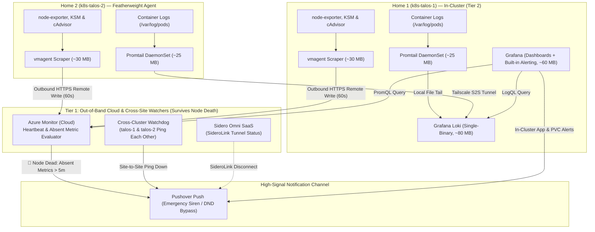
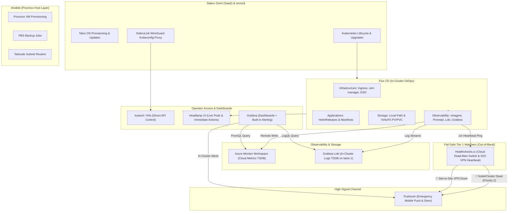

# Kubernetes Migration Plan: Multi-Home Single-Node Clusters with Talos Linux and Sidero Omni

## Table Of Contents

- [Current Status & Implementation Checklist](#current-status--implementation-checklist)
- [Purpose](#purpose)
- [Current Environment Summary](#current-environment-summary)
- [Target Architecture](#target-architecture)
  - [Cluster Topology: Independent Single-Node Clusters](#cluster-topology-independent-single-node-clusters)
  - [Management Layer: Sidero Omni SaaS & omnictl](#management-layer-sidero-omni-saas--omnictl)
  - [Dashboard & Workload Visibility: Headlamp](#dashboard--workload-visibility-headlamp)
  - [Observability Architecture: Multi-Cluster Metrics, Centralized Logs & Alerting Pipeline](#observability-architecture-multi-cluster-metrics-centralized-logs--alerting-pipeline)
  - [GitOps Engine: Flux CD](#gitops-engine-flux-cd)
  - [Operational Tooling Separation](#operational-tooling-separation)
- [Networking And Ingress](#networking-and-ingress)
  - [Omni Default CNI (Flannel) & Network Policies](#omni-default-cni-flannel--network-policies)
  - [Ingress Controller, TLS, and DNS Automation](#ingress-controller-tls-and-dns-automation)
- [Authentication And Authorization](#authentication-and-authorization)
  - [Omni Control Plane Access](#omni-control-plane-access)
  - [Kubernetes API Access](#kubernetes-api-access)
  - [Headlamp Dashboard Access](#headlamp-dashboard-access)
- [Secrets Management](#secrets-management)
- [Storage And Backup](#storage-and-backup)
  - [Storage Classes](#storage-classes)
  - [Backup Strategy & Disaster Recovery](#backup-strategy--disaster-recovery)
- [GitOps Repository Layout](#gitops-repository-layout)
- [Migration Sequence](#migration-sequence)
  - [Phase 0: Prerequisites & Omni Account Setup](#phase-0-prerequisites--omni-account-setup)
  - [Phase 1: Home 1 Cluster Bootstrap & Platform Foundation](#phase-1-home-1-cluster-bootstrap--platform-foundation)
  - [Phase 2: Home 2 Cluster Bootstrap & Multi-Cluster GitOps](#phase-2-home-2-cluster-bootstrap--multi-cluster-gitops)
  - [Phase 3: Platform Ingress TLS & Disaster Recovery](#phase-3-platform-ingress-tls--disaster-recovery)
  - [Phase 4: Lower-Risk Application Migration](#phase-4-lower-risk-application-migration)
  - [Phase 5: Stateful & Media Workloads](#phase-5-stateful--media-workloads)
  - [Phase 6: Edge & Hardware-Bound Workloads](#phase-6-edge--hardware-bound-workloads)
  - [Phase 7: Observability Stack](#phase-7-observability-stack)
    - [Phase 7A: Metrics, Dashboards & Two-Tier Alerting (Priority 1)](#phase-7a-metrics-dashboards--two-tier-alerting-priority-1)
    - [Phase 7B: Centralized Logging with Loki & Promtail (Priority 2)](#phase-7b-centralized-logging-with-loki--promtail-priority-2)
- [Stateful Application Data Migration Runbook (LAN Direct Streaming)](#stateful-application-data-migration-runbook-lan-direct-streaming)
- [Workloads Remaining Outside Kubernetes Initially](#workloads-remaining-outside-kubernetes-initially)
- [Validation And Exit Criteria](#validation-and-exit-criteria)
- [Confirmed Decisions & Remaining Implementation Choices](#confirmed-decisions--remaining-implementation-choices)

---

## Current Status & Implementation Checklist

> [!NOTE]
> **Active Branch**: `main`
> **Overall Progress**: **Phase 0, 1, 2, 3 & 4 Complete (100%)** | **Phase 5 In Progress** | **Phase 6 & 7 Pending**

```mermaid
flowchart LR
    P0["Phase 0: Omni & GitOps<br/>(Complete)"] --> P1["Phase 1: talos-1 Core<br/>(Complete)"]
    P1 --> P2["Phase 2: talos-2 Core<br/>(Complete)"]
    P2 --> P3["Phase 3: TLS & Backups<br/>(Complete)"]
    P3 --> P4["Phase 4: Web Apps<br/>(Complete)"]
    P4 --> P5["Phase 5: Media & Storage<br/>(In Progress)"]
    P5 --> P6["Phase 6: Edge & Hardware<br/>(Pending)"]
    P6 --> P7A["Phase 7A: Metrics & Alerts<br/>(Priority 1)"]
    P7A --> P7B["Phase 7B: Centralized Logs<br/>(Priority 2)"]
    classDef done fill:#2e7d32,stroke:#1b5e20,color:#ffffff;
    classDef inprog fill:#f57f17,stroke:#e65100,color:#ffffff;
    classDef todo fill:#424242,stroke:#212121,color:#ffffff;
    class P0,P1,P2,P3,P4 done;
    class P5 inprog;
    class P6,P7A,P7B todo;
```



### Phase 0: Prerequisites & Automation
- [x] **Omni SaaS Setup**: Provisioned account and established encrypted SideroLink tunnels.
- [x] **Administrative Tooling**: Configured `omnictl` CLI, downloaded admin credentials, and verified WireGuard proxies.
- [x] **Dynamic Omni GitOps Pipeline**: Built [`.github/workflows/omni-gitops.yml`](../.github/workflows/omni-gitops.yml) with automated latest `omnictl` download, template validation, and zero hardcoded secrets.
- [x] **Installation Media**: Generated declarative media presets ([`media/talos-1.yaml`](Omni/media/talos-1.yaml), [`media/talos-2.yaml`](Omni/media/talos-2.yaml)) with QEMU guest agent extensions.
- [x] **Machine Classes & Auto-Labeling**: Configured Omni machine selectors for `pve-1` and `pve-2`.

### Phase 1: Home 1 Cluster Bootstrap (`k8s-talos-1`) — COMPLETE
- [x] **VM Provisioning**: Booted `talos-1` on Proxmox `pve-1` and registered via SideroLink.
- [x] **Cluster Template Sync**: Applied [`Omni/clusters/k8s-talos-1.yaml`](Omni/clusters/k8s-talos-1.yaml) with single-node scheduling and Flannel native NetworkPolicies.
- [x] **Automated etcd Backups**: Scheduled hourly S3 backups via Omni backup controller.
- [x] **Inter-Site Networking**: Configured site-to-site static routes via Tailscale router (`192.168.10.7`).
- [x] **Flux CD Bootstrap**: Deployed Flux CD toolkit reconciling from `clusters/k8s-talos-1`.
- [x] **Ingress & Gateway API**: Deployed Traefik with Gateway API CRDs and `traefik-gateway` listening on `hostPort: 80/443`.
- [x] **Persistent Storage**: Deployed Rancher Local Path Provisioner as default StorageClass (`local-path`).
- [x] **Secrets Management**: Deployed External Secrets Operator connected to Azure Key Vault via Microsoft Entra Workload Identity Federation.
- [x] **Structured Authentication (OIDC)**: Applied [`patches/oidc-azure-ad.yaml`](Omni/clusters/patches/oidc-azure-ad.yaml) (`KubeAuthenticationConfig`) enabling Microsoft Entra ID authentication on `kube-apiserver`.
- [x] **Control Plane RBAC**: Deployed [`infrastructure/system-rbac/apiserver-kubelet.yaml`](infrastructure/system-rbac/apiserver-kubelet.yaml) to authorize `apiserver-kubelet-client` for kubelet webhook authorization.
- [x] **Headlamp Dashboard**: Deployed Headlamp v0.46.0 with Flux UI plugin, Gateway API routing (`headlamp.talos-1.gwebs.ca`), Entra ID OIDC SSO, and static breakglass token secret.

### Phase 2: Home 2 Cluster Bootstrap (`k8s-talos-2`) — COMPLETE
- [x] **VM Provisioning**: Booted `talos-2` on Proxmox `pve-2` and registered via SideroLink.
- [x] **Cluster Template Sync**: Applied [`Omni/clusters/k8s-talos-2.yaml`](Omni/clusters/k8s-talos-2.yaml) with single-node scheduling, Flannel NetworkPolicies, and hourly etcd S3 backups.
- [x] **Structured Authentication**: Synchronized `KubeAuthenticationConfig` patch to `k8s-talos-2` control plane.
- [x] **Control Plane RBAC**: Applied `ClusterRoleBinding/apiserver-kubelet-admin` on `k8s-talos-2`.
- [x] **Bootstrap Flux CD**: Run `kubectl apply -k K8s/clusters/k8s-talos-2` to install Flux controllers on `k8s-talos-2`.
- [x] **Reconcile Platform Infrastructure**: Flux reconciliation of Traefik, Local Path Storage, External Secrets Operator, and Headlamp on `k8s-talos-2`.
- [x] **Verify Headlamp SSO**: Test Microsoft Entra ID sign-in on `https://headlamp.talos-2.gwebs.ca`.
- [x] **Multi-Cluster Federation in Headlamp**: Enabled bidirectional cross-cluster management and OIDC token broadcasting across both `k8s-talos-1` and `k8s-talos-2` via External Secrets Operator templated kubeconfig with zero credentials committed to Git.

### Phase 3: Platform Ingress TLS & Disaster Recovery — COMPLETE
- [x] **cert-manager Deployment**: Deploy cert-manager via Flux in [`infrastructure/cert-manager/`](infrastructure/cert-manager/) with CRDs enabled.
- [x] **Azure DNS Secret / Credentials**: Configure Azure DNS SP credentials via External Secrets Operator (`azure-dns-secret` syncing `k8s-app-secret`).
- [x] **Let's Encrypt ClusterIssuers**:
  - Deploy `letsencrypt-staging` and `letsencrypt-prod` `ClusterIssuer` with Azure DNS DNS-01 ACME solver for `gwebs.ca`.
- [x] **Wildcard TLS Certificates**:
  - Deploy wildcard `Certificate` for `*.talos-1.gwebs.ca` on `k8s-talos-1` and attach to `traefik-gateway`.
  - Deploy wildcard `Certificate` for `*.talos-2.gwebs.ca` on `k8s-talos-2` and attach to `traefik-gateway`.
- [x] **VolSync Operator Deployment**: Deploy VolSync via Flux in [`infrastructure/storage/volsync/`](infrastructure/storage/volsync/) with CRDs enabled across `k8s-talos-1` and `k8s-talos-2`.
- [x] **Cloud Storage Secret Configuration**: Configure Azure Blob Storage (`gjtalossa`) repository secret and Restic credentials (`volsync-restic-password`) via External Secrets Operator.
- [x] **Data Replication & Standby Verification**: Validate asynchronous cross-cluster volume replication and offsite snapshots (`ReplicationSource` on `k8s-talos-1`, `ReplicationDestination` on `k8s-talos-2` via Termix workload).

### Phase 4: Lower-Risk Application Migration — COMPLETE
- [x] **Stirling-PDF**: Deploy PDF manipulation suite with Local Path PVC and TLS Gateway route on `k8s-talos-1`.
- [x] **FinGlass / StockBot**: Financial tracking and alerting tools migrated to `local-path` persistent storage.
- [x] **Discord Bots (JokeBot & MusicBot)**: Multi-container deployment replacing legacy `joke-de-jean`.
- [x] **Termix**: Web-based SSH terminal with VolSync cross-cluster replication (Active on `k8s-talos-1`, Warm Standby on `k8s-talos-2`).
- [x] **Homepage**: Single unified multi-home dashboard running statelessly on `k8s-talos-1` and `k8s-talos-2`.
- [x] **UpSnap**: Independent multi-cluster Wake-on-LAN instances running with host networking and `NET_RAW` capability on both `k8s-talos-1` and `k8s-talos-2`.
- [x] **Azure DNS DDNS Updater**: Lightweight CronJob running exclusively on `k8s-talos-1` (every 15m) using `mcr.microsoft.com/azure-cli` to synchronize residential WAN IP to `gaming.gwebs.ca` and CNAME aliases via `k8s-app` Service Principal in Azure Key Vault.

### Phase 5: Stateful & Media Workloads (In Progress)
- [x] **VirtioFS Storage on talos-1**: Attach Proxmox VirtioFS Directory Mapping `Vault` (`/mnt/Vault`) to VM `talos-1` and apply Talos `ExternalVolumeConfig` machine patch for native ZFS pool access (`/var/mnt/vault`) with declarative `ReadWriteMany` PV/PVC.
- [x] **In-Cluster Samba Service**: Deploy declarative Samba container on `k8s-talos-1` with `hostPort: 445`, mounting VirtioFS volume at `/mnt/Vault` using existing `etc/samba/smb.conf` and Azure Key Vault credentials via ESO, enabling complete decommissioning of the Ubuntu VM.
- [x] **Developer Stack**: Migrate Gitea with SQLite3 and Hermes AI agent gateway with Local Path persistent storage on `k8s-talos-1`.
- [x] **Media Companion Stack (Part 1 - Stateless/Config Only)**: Migrate Overseerr, Prowlarr/Jackett, and FlareSolverr via LAN Direct Streaming into `local-path` PVCs with Gateway API routing.
- [x] **VPN & Download Stack**: Deploy Gluetun VPN container with qBittorrent sidecar mounting `medias-pv` (`/medias/downloads`, UID 950:950) with verified kill-switch and direct ZFS write performance.
- [x] **Media Companion Stack (Part 2 - Media Managers)**: Migrate Sonarr and Radarr via LAN Direct Streaming into `local-path` PVCs, mount `medias-pv` (`/medias`, UID 950:950), and validate instant atomic hardlinking from downloads to library datasets.
- [x] **Plex Media Server**: Add NVIDIA extensions (`siderolabs/nonfree-kmod-nvidia-lts`, `siderolabs/nvidia-container-toolkit-lts`), configure GPU passthrough on `talos-1`, and mount `medias-pvc` via VirtioFS for 4K direct stream and NVENC transcode validation.
- [ ] **OneDrive Rclone Sync CronJob**: Deploy scheduled rclone sync CronJob mounting `vault-pv` (`/mnt/Vault/OneDrive`, UID 1000:1000) with credentials managed via External Secrets Operator.

### Phase 6: Edge & Hardware-Bound Workloads (Pending)
- [ ] **Home Assistant**: Deploy on `talos-2` with host networking and Zigbee coordinator integration.

### Phase 7: Observability Stack (Pending)

#### Phase 7A: Metrics, Dashboards & Two-Tier Alerting (Rollout Priority 1)
- [ ] **Azure Monitor Workspace & Key Vault Secrets**: Provision Azure Monitor Workspace for Prometheus TSDB; create Entra ID App Registration (`Monitoring Metrics Publisher`, `Monitoring Data Reader`); sync credentials (`monitoring/azure-prom-auth`) via External Secrets Operator.
- [ ] **Metrics Collection (`vmagent`)**: Deploy ultra-lightweight `vmagent` (~30MB RAM) on `k8s-talos-1` and `k8s-talos-2` scraping Kubernetes node metrics (`node-exporter`), cluster state (`kube-state-metrics`), container runtime (`cAdvisor`), Traefik ingress, cert-manager, and VolSync.
- [ ] **Cost & Storage Optimization**: Apply remote-write sample pruning (60s scrape intervals, drop `*_bucket` and `^go_.*`/`^process_.*` runtime series) to guarantee <$0.50/mo total Azure cost with local disk buffer fallback.
- [ ] **Tier 1 Out-of-Band Dead Man's Switch (Healthchecks.io + Pushover)**: Deploy featherweight 1-minute heartbeat CronJob on `talos-1` and `talos-2` pinging Healthchecks.io endpoints (`https://hc-ping.com/<uuid>`); Healthchecks.io fires Pushover Emergency sirens (Priority 2) if a single node dies, crashes, or loses power/WAN.
- [ ] **Tailscale Site-to-Site VPN Monitoring**: Implement end-to-end monitoring of the Home 1 (`192.168.10.0/24`) <-> Home 2 (`192.168.15.0/24`) tunnel via cross-cluster heartbeat CronJob (Tier 1 via Healthchecks.io) and synthetic metric probes (`probe_success`, latency) with Grafana alerts and latency dashboard panels (Tier 2).
- [ ] **Visualization Tier (Self-Hosted Grafana)**: Deploy Grafana on `k8s-talos-1` with Traefik Gateway API HTTPRoute (`grafana.talos-1.gwebs.ca`), wildcard TLS, Microsoft Entra ID OIDC SSO (`homelab-k8s-admins` mapped to Admin), and pre-provisioned Azure Managed Prometheus datasource.
- [ ] **Tier 2 In-Cluster Built-in Grafana Alerting**: Enable native Grafana Alerting (eliminating standalone Alertmanager pod bloat) with dedicated Contact Point for Pushover (Priority 2 for Critical, Priority 0 for Warning).
- [ ] **Metric Alert Rules Catalog**: Deploy declarative Prometheus alert rules covering node health, pod crashloops/OOMs, disk/PVC capacity, backup failures, ingress 5xx rates, cert expiration, and `TailscaleSiteToSiteDown`.
- [ ] **Unified Multi-Cluster Dashboards**: Provision curated Grafana dashboards with `$cluster` variable selector (Cluster Overview, Kubernetes Workloads, Node Exporter, Storage/PVCs, Traefik Ingress, and Tailscale Site-to-Site VPN).

#### Phase 7B: Centralized Logging with Loki & Promtail (Rollout Priority 2)
- [ ] **Centralized Log Aggregation (Grafana Loki)**: Deploy Loki in single-binary mode on `k8s-talos-1` backed by persistent volume storage (`local-path` PVC or Azure Blob `gjtalossa`) with automated retention compaction (14–30 days).
- [ ] **Kubernetes Pod Log Collection (Promtail)**: Deploy Promtail DaemonSet across `k8s-talos-1` and `k8s-talos-2` (in PSA privileged `monitoring` namespace) streaming `/var/log/pods` enriched with cluster, namespace, pod, and container labels.
- [ ] **Cross-Cluster Log Transport**: Route `k8s-talos-2` Promtail log streams to `k8s-talos-1` Loki securely over the Tailscale site-to-site encrypted bridge.
- [ ] **Grafana Loki Integration & LogQL Alerts**: Connect Loki datasource in Grafana, configure Loki Log Explorer dashboard, and establish LogQL error-spike alert rules.

---

## Purpose

Migrate suitable homelab Docker Compose workloads running across two separate physical homes to **Talos Linux Kubernetes**, centrally managed through the **Sidero Omni SaaS platform**.

The architecture establishes **one single-node cluster in each home**, providing complete failure isolation and zero cross-WAN dependencies, while maintaining a unified management and deployment model:
- **Sidero Omni SaaS** provides the control and management plane for Talos machine lifecycle, OS upgrades, automated Kubernetes version management, and secure remote SideroLink tunnels.
- **`omnictl`** serves as the administrative CLI for machine registration, cluster templates, and credential provisioning.
- **`kubectl`** and **K9s** serve as the day-to-day Kubernetes management tools, connecting over Omni's secure WireGuard proxy without exposing API ports to the public internet.
- **Headlamp** acts as the user-friendly, in-cluster Kubernetes dashboard for application monitoring, logs, pod inspection, and resource visibility.
- **Flux CD** reconciles declarative infrastructure and application manifests from this monorepo, keeping both clusters configured independently from a shared Git foundation.
- **Ansible** continues to manage underlying Proxmox virtual machines, host hardware passthrough, NAS configuration, and Tailscale routing.

---

## Current Environment Summary

- **Physical Sites**:
  - **Home 1 (`pve-1`)**: Hosts the primary VM infrastructure including `Docker-1` (Traefik, Plex companion apps, WebUI, utilities), `DNS-1` (AdGuard Home), `Plex-1` (media server with GPU), `Gaming-1`, and native Proxmox ZFS storage pool (eliminating dedicated storage VMs).
  - **Home 2 (`pve-2`)**: Hosts secondary VM infrastructure including `Docker-2` (Traefik, Home Assistant, PDF, utilities) and `DNS-2` (AdGuard Home).
- **Inter-Site Networking**: Tailscale site-to-site routers bridge the subnets between homes.
- **Application State**: Workloads currently use host-local `/Apps/...` bind mounts.
- **Storage Architecture**:
  - The primary storage pool runs on **native Proxmox ZFS** on `pve-1`.
  - Storage is shared directly into the **`talos-1` VM** via **Talos native VirtioFS** (`ExternalVolumeConfig` over hypervisor shared memory), eliminating network bottlenecks and enabling instant atomic hardlinks for the media/torrent stack.
  - An **in-cluster Samba container** on `k8s-talos-1` mounts the VirtioFS volume and binds to port 445 on node IP `192.168.10.15` to serve SMB shares across the LAN (replacing the dedicated Ubuntu/NAS VM entirely).
- **Ingress & TLS**: Traefik currently acts as reverse proxy, handling Let's Encrypt DNS-01 challenges via Azure DNS.
- **Identity & Secrets**: Microsoft Entra ID provides identity, and Azure Key Vault holds sensitive configuration.

---

## Target Architecture

### Cluster Topology: Independent Single-Node Clusters

Rather than stretching a single Kubernetes cluster across two residential WAN links (which introduces etcd latency spikes, quorum loss hazards, and split-brain failures when the inter-site tunnel drops), the environment will run **two independent single-node clusters**:

```text
               +-------------------------------------------+
               |             Sidero Omni (SaaS)            |
               |       https://omni.siderolabs.com         |
               +---------------------+---------------------+
                                     |
                SideroLink WireGuard | Encrypted Tunnels
                                     |
               +---------------------+---------------------+
               |                                           |
               v                                           v
    +----------------------+                   +----------------------+
    |    Home 1 (pve-1)    |                   |    Home 2 (pve-2)    |
    |  Cluster: k8s-talos-1|                   |  Cluster: k8s-talos-2|
    |                      |                   |                      |
    |  +----------------+  |                   |  +----------------+  |
    |  | Node: talos-1  |  |                   |  | Node: talos-2  |  |
    |  | (Control Plane)|  |                   |  | (Control Plane)|  |
    |  +----------------+  |                   |  +----------------+  |
    |  - Omni CNI (Flannel)|                   |  - Omni CNI (Flannel)|
    |  - Traefik Ingress   |                   |  - Traefik Ingress   |
    |  - Flux CD           |                   |  - Flux CD           |
    |  - Headlamp          |                   |  - Headlamp          |
    |  - Local Storage     |                   |  - Local Storage     |
    |  - VirtioFS (ZFS)    |                   |  - Local Services    |
    +----------------------+                   +----------------------+
               ^                                           ^
               |                                           |
               +================= Tailscale ===============+
                                Site-to-Site
```

| Node Name | Cluster Name | Location / Host | Machine Role | Scheduling | Primary Workload Scope |
| --- | --- | --- | --- | --- | --- |
| `talos-1` | `k8s-talos-1` | Home 1 (`pve-1` VM) | Talos Control Plane | `allowSchedulingOnControlPlanes: true` | Web apps, dev tools, media companion stack, monitoring |
| `talos-2` | `k8s-talos-2` | Home 2 (`pve-2` VM) | Talos Control Plane | `allowSchedulingOnControlPlanes: true` | Local home services, remote utility apps, secondary tooling |

#### Benefits of Single-Node Clusters in Each Home:
1. **Zero Cross-Site Failure Coupling**: If Home 1 loses power or internet, Home 2's cluster continues running unaffected (and vice versa). Local home automation and internal DNS remain fully operational.
2. **Simplified Storage & Scheduling**: Local volumes have zero failover ambiguity. There is no need for complex distributed block storage (Ceph/Longhorn) that requires 3+ nodes and high-bandwidth interconnects.
3. **No Control Plane / Worker Split Overhead**: In small footprint setups, dedicating separate VMs for control plane and workers wastes CPU and RAM on redundant kernel and etcd overhead. Single-node Talos with schedulable control plane runs workloads efficiently on 100% of the allocated resources.
4. **Independent Maintenance Windows**: Either home cluster can be rebooted, upgraded, or reconfigured without impacting the other site.

---

### Management Layer: Sidero Omni SaaS & omnictl

Sidero Omni is the cloud-hosted management platform purpose-built for Talos Linux:

- **Machine Bootstrapping**: Talos VMs boot using an Omni-generated boot media (ISO or kernel image) configured with the Omni account registration URL and secure token.
- **SideroLink WireGuard Mesh**: Each Talos machine establishes an encrypted, outbound-only WireGuard tunnel to Omni. This eliminates the need to expose Kubernetes API ports or Talos API ports to the public internet or configure port forwarding on residential routers.
- **Declarative Cluster Templates**: Clusters are defined and managed declaratively via Omni Cluster Templates (`omni.siderolabs.io/v1alpha1`).
- **Control Plane Schedulability**: For single-node clusters, the cluster template applies an inline machine config patch:
  ```yaml
  patches:
    - name: allow-controlplane-workloads
      inline:
        cluster:
          allowSchedulingOnControlPlane: true
  ```
- **CLI Management (`omnictl`)**:
  - `omnictl cluster template sync -f ...`: Applies declarative cluster specifications.
  - `omnictl cluster upgrade ...`: Executes zero-downtime or controlled OS and Kubernetes version upgrades.
  - `omnictl kubeconfig`: Generates a kubeconfig routed securely through the Omni SideroLink proxy to the target cluster.
  - `omnictl talosconfig`: Generates client configuration for direct Talos OS API operations.

---

### Dashboard & Workload Visibility: Headlamp

**Headlamp** is the Kubernetes web UI dashboard for developers and administrators:
- **Deployment**: Deployed as an in-cluster workload via Flux HelmRelease in each cluster (or configured to view both clusters from a single UI).
- **Authentication**: Secured with Microsoft Entra ID OIDC (either natively or via an `oauth2-proxy` front end), ensuring single sign-on consistency with existing homelab tools.
- **Role**: Headlamp provides read/write visualization for Pods, Deployments, Persistent Volumes, CronJobs, Helm releases, events, and container logs.
- **Separation of Concerns**:
  - **Omni SaaS UI**: Used for node hardware status, Talos OS configuration, cluster bootstrapping, and Talos upgrades.
  - **Headlamp UI**: Used for day-to-day Kubernetes workload monitoring, log viewing, and pod inspection.
  - **Flux CD**: Serves as the sole authoritative deployment engine—changes are made via Git commits, not manual UI clicks.

---

### Observability Architecture: Multi-Cluster Metrics, Centralized Logs & Alerting Pipeline

In a single-node cluster environment, monitoring architecture must solve two critical realities:
1. **Simplicity First**: Avoid heavy operators, complex microservice CRDs, and redundant daemons. Total resource footprint must stay under ~200 MB RAM per node.
2. **The Single-Node Paradox ("Who Watches the Watcher?")**: If a single-node cluster suffers a power outage, kernel panic, hypervisor crash, or network cut, **every in-cluster monitoring and alerting pod dies with it**. An in-cluster alerting container cannot alert you that its own host is dead!

To solve both challenges cleanly, observability is organized into **Three Core Pillars** backed by a **Two-Tier Fail-Safe Alerting Model**:



---

#### Two-Tier Fail-Safe Alerting Model (Solving the Single-Node Paradox)

> [!IMPORTANT]
> **Who Watches the Watcher?**
> In a single-node cluster, in-cluster alerting pods cannot notify you that the cluster is dead because they go down with the node. Therefore, alerting is decoupled into two independent tiers:
> 1. **Tier 1 (Out-of-Band Cloud & Cross-Site Watchers)**: Detects complete node/cluster death, power cuts, hypervisor crashes, and internet cuts.
> 2. **Tier 2 (In-Cluster Built-in Grafana Alerting)**: Detects workload issues, pod crashloops, disk capacity warnings, backup failures, and log errors while the node is operating.

##### Tier 1: Out-of-Band Dead Man's Switch & S2S VPN Watcher (Survives Node Death)
1. **Healthchecks.io Dead Man's Switch (Survives Complete Node Death)**:
   - Gabriel already has **Healthchecks.io** in place. Healthchecks.io is purpose-built as an external dead-man's switch with native Pushover integration.
   - Each single-node cluster runs a featherweight 1-minute heartbeat CronJob (`curlimages/curl`, ~5 MB RAM) pinging its respective Healthchecks.io endpoint (`https://hc-ping.com/<uuid>`).
   - If a node suffers hardware failure, kernel panic, hypervisor crash, power cut, or residential WAN drop, the ping stops. After the grace period (e.g. 2–3 minutes), Healthchecks.io independently triggers a **Pushover Emergency Siren (Priority 2 with 60s retries)**:
     `🚨 [CRITICAL] Cluster k8s-talos-1 is DOWN (Missed heartbeat ping for 2m)`.
   - **Zero Cloud Infrastructure Overhead**: Eliminates the need for custom Azure Action Group webhook bridges or lambda proxies.
2. **Tailscale Site-to-Site LAN VPN Heartbeat (Home 1 <-> Home 2)**:
   - The two homes are bridged via `tailscale-lan-s2s-gateway` connecting `192.168.10.0/24` and `192.168.15.0/24`.
   - `k8s-talos-1` runs a scheduled check testing connectivity to `192.168.15.15:443` across the tunnel; on success, it pings its S2S check endpoint on Healthchecks.io.
   - `k8s-talos-2` runs a reciprocal check testing `192.168.10.15:443` and pings its endpoint.
   - If the Tailscale S2S bridge drops while both nodes are alive, the healthcheck misses its heartbeat and triggers:
     `🚨 [CRITICAL] Tailscale Site-to-Site VPN is DOWN (Cross-site ping failed)`.
3. **Sidero Omni SaaS Heartbeat**:
   - Omni SaaS maintains persistent SideroLink WireGuard tunnels to each Talos node. If a node disconnects, Omni SaaS detects the outage immediately.

##### Tier 2: Streamlined In-Cluster Alerting (Built-in Grafana Alerting)
- **Eliminating Component Bloat**: Instead of deploying and maintaining a separate standalone Alertmanager pod, CRDs, and config operators, we utilize **native Grafana Alerting** built directly into the Grafana container!
- Evaluates PromQL rules against Azure Monitor and LogQL rules against Loki.
- Manages deduplication, grouping, and direct dispatch to **Pushover** (Priority 2 for Critical, Priority 0 for Warning) without any extra infrastructure.

---

#### Pillar 1: Metrics Architecture (Simple & Lightweight)

1. **Featherweight Scraper (`vmagent`)**:
   - Avoids heavy Prometheus operator pods (~400 MB–1 GB RAM). Uses single `vmagent` container (~30 MB RAM per node).
   - Scrapes local Kubernetes components: `node-exporter` (host metrics), `kube-state-metrics` (object states), `cAdvisor` (container CPU/memory), `traefik` (ingress request rates & 5xx latencies), `cert-manager` (TLS cert expiration), and `volsync` (backup statuses).
2. **Outbound HTTPS Remote Write to Azure Monitor**:
   - Zero public inbound firewall ports. Pushes outbound over TCP 443 with Entra ID OAuth2 authentication (managed via External Secrets Operator syncing `azure-prom-auth`).
3. **Resilient Local Disk Queuing (Zero WAN Data Loss)**:
   - Configured with `-remoteWrite.tmpDataPath=/var/vmagent-data` on local storage. If residential internet drops, `vmagent` buffers samples to disk and flushes upon reconnection with zero data holes.
4. **Cost Engineering (<$0.50 / Month Guarantee)**:
   - 60s scrape intervals and drop filters (`*_bucket`, `^go_.*`, `^process_.*`) keep monthly sample volume low (~15M–25M samples/month across both clusters), resulting in a predictable bill of **~$0.30 to $0.40/month**.
5. **Multi-Cluster Federation**:
   - Metrics are tagged with `external_labels: { cluster: "k8s-talos-1" }` or `{ cluster: "k8s-talos-2" }`, selectable via a `$cluster` dropdown in Grafana.

---

#### Pillar 2: Centralized Logging (Single-Binary Loki & Promtail)

1. **Kubernetes Host Log Collection (`Promtail` DaemonSet)**:
   - Tails host container logs from `/var/log/pods/` on Talos Linux.
   - Deployed in namespace `monitoring` with `pod-security.kubernetes.io/enforce: privileged`.
   - Enriches log lines with Kubernetes metadata (`cluster`, `namespace`, `pod`, `container`, `stream`).
2. **Central Log Engine (`Grafana Loki` Single-Binary)**:
   - Deployed on `k8s-talos-1` in simple single-binary mode with TSDB index.
   - Stored on persistent volume storage (`local-path` PVC or Azure Blob Storage `gjtalossa`).
   - Automatically compacts and deletes logs older than 14–30 days.
3. **Cross-Cluster Log Forwarding over Tailscale**:
   - `k8s-talos-2` Promtail ships container logs directly over the encrypted Tailscale bridge to Loki on `k8s-talos-1`. If WAN is interrupted, Promtail buffers positions locally.

---

#### Pillar 3: High-Signal Alerting Matrix & Notification Channels

##### Notification Dispatch Strategy:
- **Pushover (Dedicated Mobile & Desktop Push Notification Channel)**:
  - **Single Authoritative Channel**: Unified with existing Flux GitOps notification infrastructure in Key Vault (`pushover-token`, `pushover-user-key`).
  - **Critical Alerts**: Dispatched with **Emergency Priority (`priority: 2`)**, siren sound, 60s retries until acknowledged, and automatic bypass of iOS/Android Do Not Disturb / Focus modes.
  - **Warning Alerts**: Dispatched with **Normal Priority (`priority: 0`)**.
  - **Info / Resolved**: Dispatched with **Low Priority (`priority: -1`)** (quiet delivery).
  - Includes direct clickable deep links jumping to Grafana dashboards and Headlamp pod diagnostics.

##### Production Alert Rules Matrix:

| Category | Alert Name | Evaluator | Severity | Condition / PromQL / LogQL | Impact & Action Required |
| :--- | :--- | :--- | :--- | :--- | :--- |
| **Cluster** | `ClusterDown` | **Azure Cloud (Tier 1)** | **Critical** | `absent_over_time(up{cluster="k8s-talos-1"}[5m]) == 1` | **Node power outage, hardware death, or hypervisor crash**. Survives node failure! |
| **Cluster** | `SiteToSiteDown` | **Cross-Cluster (Tier 1)** | **Warning** | `probe_success{instance="192.168.15.15"} == 0` for 3m | Inter-home Tailscale link interrupted. Verify site routers. |
| **Node** | `NodeDiskSpaceFillingFast` | **Grafana (Tier 2)** | **Critical** | `predict_linear(node_filesystem_free_bytes[4h], 86400) < 0` | Root or storage disk will exhaust space within 24h. Prune logs/volumes. |
| **Node** | `NodeMemoryPressure` | **Grafana (Tier 2)** | **Warning** | `(1 - node_memory_MemAvailable_bytes / node_memory_MemTotal_bytes) > 0.85` for 15m | Host RAM utilization exceeded 85%. Inspect top consumers. |
| **Node** | `NodeCPUSaturation` | **Grafana (Tier 2)** | **Warning** | `100 - (avg by (instance) (rate(node_cpu_seconds_total{mode="idle"}[5m])) * 100) > 90` for 15m | Sustained high CPU load. Check transcode jobs or runaway processes. |
| **Workload**| `PodCrashLooping` | **Grafana (Tier 2)** | **Critical** | `increase(kube_pod_container_status_restarts_total[10m]) > 3` | Container repeatedly crashing. Inspect logs in Headlamp/Loki. |
| **Workload**| `PodOOMKilled` | **Grafana (Tier 2)** | **Warning** | `kube_pod_container_status_last_terminated_reason{reason="OOMKilled"} == 1` | Container exceeded memory limits. Increase memory limit in GitOps. |
| **Workload**| `PodNotReady` | **Grafana (Tier 2)** | **Warning** | `kube_pod_status_phase{phase=~"Pending\|Unknown"} == 1` for 10m | Workload failed to start. Check PVC binding or image pull. |
| **Workload**| `JobFailed` | **Grafana (Tier 2)** | **Warning** | `kube_job_status_failed > 0` | Scheduled CronJob failed (e.g. DDNS updater, OneDrive rclone). Inspect logs. |
| **Storage** | `PersistentVolumeFillingFast`| **Grafana (Tier 2)**| **Warning / Critical**| `kubelet_volume_stats_used_bytes / kubelet_volume_stats_capacity_bytes > 0.85` | PVC nearing capacity. Expand PVC in GitOps. |
| **Storage** | `VolSyncReplicationFailed` | **Grafana (Tier 2)** | **Critical** | `volsync_replicationsource_last_sync_status != 1` for 1h | Offsite volume backup snapshot failed. Verify Azure Blob credentials. |
| **Storage** | `VirtioFSMountDown` | **Grafana (Tier 2)** | **Critical** | `node_mountstats_nfs_total == 0` or missing `/var/mnt/vault` | VirtioFS ZFS pool unmounted on `talos-1`. Check Proxmox NUMA / mount tag. |
| **Ingress** | `TraefikHigh5xxErrorRate` | **Grafana (Tier 2)** | **Critical** | `sum(rate(traefik_service_requests_total{code=~"5.."}[5m])) / sum(rate(traefik_service_requests_total[5m])) * 100 > 5` | Over 5% of web requests failing with 5xx errors. Backend service down. |
| **Ingress** | `CertExpiringSoon` | **Grafana (Tier 2)** | **Warning / Critical**| `certmanager_certificate_expiration_timestamp_seconds - time() < 14 * 86400` | Let's Encrypt wildcard cert expiring in <14 days. Inspect cert-manager. |
| **App** | `VPNKillswitchTriggered` | **Grafana (Tier 2)** | **Critical** | `container_network_receive_bytes_total{container="gluetun"} == 0` for 5m while qB active | Torrent VPN connection dropped and kill-switch blocked traffic. |
| **Logs** | `LogFatalErrorSpike` | **Grafana (Tier 2)** | **Critical** | `sum(rate({namespace=~".+"} \|= "fatal" [5m])) > 5` | Spike in fatal application crashes across workloads. Drill down in Loki. |

---

#### Pillar 4: Visualization & Dashboards (Self-Hosted Grafana)

1. **Lightweight Self-Hosted Instance ($0 / Month)**:
   - Deployed on `k8s-talos-1` via Flux HelmRelease, eliminating the ~$42/month fee for Azure Managed Grafana while preserving cloud TSDB metric durability.
   - Exposed securely via Traefik Gateway API at `https://grafana.talos-1.gwebs.ca` with cluster wildcard TLS.
2. **Microsoft Entra ID OIDC SSO**:
   - Single sign-on integrated with existing homelab Entra ID tenant.
   - Role mapping: Users belonging to security group `homelab-k8s-admins` automatically receive `Admin` privileges; other authenticated users receive `Viewer`.
3. **Unified Datasources**:
   - **Metrics TSDB**: Azure Managed Prometheus.
   - **Central Logs**: Grafana Loki (queryable with LogQL, live stream log tailing).
4. **Curated Multi-Cluster Dashboard Catalog**:
   - **Multi-Cluster Overview**: Node CPU/RAM utilization, cluster scheduling capacity, pod health counts, and cluster switcher dropdown (`$cluster`: `k8s-talos-1`, `k8s-talos-2`).
   - **Kubernetes Workloads**: CPU/Memory throttles, pod restart counts, and live logs displayed side-by-side with metric spikes.
   - **Loki Log Explorer**: Full-text log searching with streaming log output, multi-stream regex filters, and log level histograms.
   - **Node Exporter Full**: Detailed hardware metrics, disk I/O latency, network interface throughput, and host memory buffers.
   - **Storage & PVC Health**: Disk utilization per volume, ZFS dataset capacity, and VolSync snapshot timestamps.
   - **Traefik Ingress Traffic**: Request volumes, response latency percentiles (p50, p95, p99), HTTP status codes (2xx, 4xx, 5xx), and active TLS sessions.

---

### GitOps Engine: Flux CD

Flux CD runs inside each cluster, continuously reconciling desired state from the Git repository:

- **Monorepo Structure**: A unified repository root manages both clusters, sharing common application definitions and infrastructure operators while maintaining separate cluster overlays (`clusters/k8s-talos-1` and `clusters/k8s-talos-2`).
- **Independent State**: Each cluster has its own `Kustomization` and `HelmRelease` manifests, allowing cluster-specific sizing, volume mappings, and environment variables.
- **Automated Upgrades**: Flux works seamlessly with Renovate Bot to detect and open PRs for Helm chart and container image updates.
- **Continuous Validation**: GitHub Actions runs `kubeconform` and Kustomize dry-runs on pull requests before merging to `main`.

#### GitOps Bootstrap & Schema Integrity Rules (Zero-Friction Guarantee):
1. **Native Two-Stage Bootstrap Ordering**:
   - When bootstrapping a brand-new cluster into GitOps from zero, the Kubernetes API server cannot accept Custom Resources (`Kustomization`, `GitRepository`) before their CRD schemas are fully registered.
   - Follow standard native Kubernetes bootstrap ordering using `kubectl`:
     ```bash
     # 1. Install Flux namespace, CRDs, and controllers
     kubectl --context <context> apply -f K8s/clusters/<cluster>/flux-system/gotk-components.yaml

     # 2. Apply cluster root GitOps definitions (GitRepository + Kustomizations)
     kubectl --context <context> apply -k K8s/clusters/<cluster>
     ```
   - Alternatively, if running `kubectl apply -k K8s/clusters/<cluster>` in a single shot, re-run the same command once more after CRDs register to bind the custom resources.
   - Once applied, Flux takes over 100% autonomously without manual intervention.
2. **Strict HelmRelease Schema Integrity**:
   - Modern Helm charts enforce strict JSON schema validation (`values.schema.json`).
   - Legacy, renamed, or misspelled chart parameters (e.g. Traefik v2 vs v3 flags) cause Helm controller failures that block Flux health checks.
   - Always verify `values.yaml` against upstream chart documentation or JSON schema before committing to Git.
3. **Single-Node Declarative Control-Plane Schedulability**:
   - In single-node Talos clusters (`talos-1`, `talos-2`), the control-plane taint must be removed declaratively in Omni cluster templates ([patches/allow-controlplane.yaml](file:///home/gabriel/HomeLab/K8s/Omni/clusters/patches/allow-controlplane.yaml) using `kind: KubeNodeConfig` with `taints: node-role.kubernetes.io/control-plane: $patch: delete`).
   - Nodes must never rely on manual `kubectl taint` commands; they must boot ready to schedule user workloads from birth.
4. **Pod Security Admission (PSA) for Host/Privileged Namespaces**:
   - Any namespace utilizing `hostPath` (e.g. `local-path-storage`) or `hostPort` (e.g. `traefik`) must have explicit `pod-security.kubernetes.io/enforce: privileged` labels declared on its `Namespace` manifest to avoid admission controller rejections on Kubernetes 1.31+.

---

### Operational Tooling Separation

To ensure clean administrative boundaries, each tool is assigned a distinct responsibility:



| Tool / Layer | Scope & Responsibility | Access / Interface |
| --- | --- | --- |
| **Sidero Omni** | Talos OS machine provisioning, maintenance, OS/k8s upgrades, and etcd snapshot health. | Omni SaaS UI & `omnictl` |
| **Flux CD** | Declarative GitOps reconciliation of infrastructure, observability, and workloads from Git. | Git commits & PRs |
| **Headlamp** | In-cluster, real-time workload inspection, container live logs, event viewing, and pod restarts. | `headlamp.<cluster>.gwebs.ca` (Entra ID OIDC) |
| **Healthchecks.io** | **Tier 1 Fail-Safe**: External dead-man's switch detecting node death, power cuts, WAN drops, and Site-to-Site VPN outages. | `https://healthchecks.io/` -> Pushover |
| **vmagent (Metrics Collector)** | Ultra-lightweight metric scraper (~30 MB RAM) pushing outbound samples via HTTPS Remote Write. | In-cluster DaemonSet / Deployment |
| **Azure Monitor Workspace** | Cloud time-series database storing 18 months of historical metrics across all clusters. | Azure Monitor Workspace (Private/HTTPS) |
| **Promtail (Log Shipper)** | Host-level DaemonSet streaming `/var/log/pods` enriched with Kubernetes labels to Loki. | Host `/var/log/pods` (PSA: Privileged) |
| **Grafana Loki (Log Engine)** | Centralized log aggregation, TSDB indexing, and retention engine running on `k8s-talos-1`. | `http://loki.monitoring.svc:3100` |
| **Self-Hosted Grafana** | **Tier 2 In-Cluster Alerts & Dashboards**: Unified UI with built-in alerting to Pushover. | `https://grafana.talos-1.gwebs.ca` (Entra ID OIDC) |
| **Pushover** | Immediate mobile & desktop emergency push notifications with priority sirens bypassing DND. | Mobile app & desktop browser |
| **Ansible** | Underlying Proxmox host VMs, PBS backup scheduling, and physical networking. | SSH / Local Playbooks |

---

## Networking And Ingress

### Omni Default CNI (Flannel) & Network Policies

The clusters use the **out-of-the-box networking default** provided by Talos Linux and Sidero Omni, with native network policy enforcement enabled:
- **Flannel CNI**: Deployed and configured automatically on boot by Talos. Extremely lightweight (~30–50 MB RAM per node compared to 500 MB–1 GB+ for heavy eBPF CNI stacks), saving valuable system resources.
- **Native Kube-Proxy**: Standard Kubernetes `kube-proxy` is retained and managed natively by Talos without manual intervention.
- **Single-Node Simplicity**: Since each cluster is a single node (`talos-1` and `talos-2`), all pod-to-pod routing is host-local. Flannel manages pod IPAM seamlessly with no overlay complexity.
- **Outbound IP Firewalling & Network Policies (`kubeNetworkPoliciesEnabled: true`)**:
  By enabling the built-in network policy controller in Talos machine configuration, standard Kubernetes `NetworkPolicy` resources are fully enforced for both **Ingress** and **Egress (outbound)**:
  - **Outbound LAN Isolation**: Block pods from accessing internal home LAN subnets (e.g. `192.168.0.0/16`, `10.0.0.0/8`, `172.16.0.0/12`) while still allowing outbound internet traffic via CIDR `ipBlock` rules.
  - **Port-Based Outbound Restrictions**: Restrict pod egress strictly to authorized ports (e.g., DNS on UDP/TCP `53` and HTTPS on TCP `443`).
  - **Namespace & Database Isolation**: Completely block database or internal backend pods from initiating outbound connections to the internet or outside their namespace.
  - **Zero Third-Party Agent Overhead**: Handled by the native Linux kernel packet filtering without requiring Cilium, Calico, or custom kernel modules.

#### Example Outbound Firewall Policy (Block LAN, Allow Internet):

```yaml
apiVersion: networking.k8s.io/v1
kind: NetworkPolicy
metadata:
  name: isolate-from-lan
  namespace: default
spec:
  podSelector:
    matchLabels:
      security: restricted-egress
  policyTypes:
    - Egress
  egress:
    # 1. Allow DNS queries to cluster CoreDNS
    - to:
        - namespaceSelector: {}
          podSelector:
            matchLabels:
              k8s-app: kube-dns
      ports:
        - protocol: UDP
          port: 53
        - protocol: TCP
          port: 53
    # 2. Allow outbound internet traffic, while blocking internal LANs
    - to:
        - ipBlock:
            cidr: 0.0.0.0/0
            except:
              - 192.168.0.0/16     # Home LANs
              - 10.0.0.0/8          # Internal networks / Pod CIDRs
              - 172.16.0.0/12       # Docker / private subnets
      ports:
        - protocol: TCP
          port: 443
        - protocol: TCP
          port: 80
```

### Ingress Controller, TLS, and DNS Automation

Rather than running complex multi-node load balancers or BGP routers, traffic entry relies on the dedicated node IP and **Traefik Ingress Controller**:

```text
       Clients (LAN / Tailscale)
                   |
                   | HTTP :80 / HTTPS :443
                   v
       Node IP (talos-1 / talos-2)
                   |
                   v (hostPort 80/443)
       +-------------------------------+
       |   Traefik Ingress Controller  |
       |     (Deployed via Flux)       |
       +---------------+---------------+
                       |
        +--------------+--------------+
        |                             |
        v                             v
  HTTP Services                 HTTP Services
 (Homepage, PDF, WebUI)       (Gitea, Headlamp, etc.)
```

| Component | Responsibility | Implementation Details |
| --- | --- | --- |
| **Traefik Ingress** | External HTTP(S) entry point & reverse proxy | Deployed via official Traefik Helm chart through Flux. Binds ports `80` and `443` directly on the host using `hostPort` (or `hostNetwork: true`), matching your existing Docker setup. |
| **Routing Model** | Hostname & path routing | Modern Kubernetes **Gateway API** (`GatewayClass`, `Gateway`, `HTTPRoute`) as the primary routing standard, eliminating legacy `Ingress` resources. |
| **cert-manager** | Automated TLS certificates | Interacts with Let's Encrypt using DNS-01 ACME challenges against Azure DNS. |
| **Azure DNS Solver** | ACME challenge solver | Resolves wildcard and hostname challenges against your existing Azure DNS domains. |
| **external-dns** (Phase 2+) | DNS record synchronization | Automates creation of AdGuard Home / Azure DNS records pointing to the node IP. |

**No External LoadBalancer Required**: Because each cluster is hosted on a single VM with a fixed LAN IP, incoming traffic reaches the node directly. MetalLB, L2 announcements, and floating VIPs are eliminated entirely.

Traffic routes internally and externally via HTTPS. Certificates are securely stored in Kubernetes `Secret` resources and automatically rotated.

#### Cluster-Scoped Routing & Domain Isolation Rules:
1. **Strict Hostname Separation**:
   - Each cluster strictly serves its own domain namespace, following the established homelab pattern:
     - **Home 1 (`k8s-talos-1`)**: `<app>.talos-1.gwebs.ca`
     - **Home 2 (`k8s-talos-2`)**: `<app>.talos-2.gwebs.ca`
   - **Core Rule**: A route resource (`HTTPRoute`) must **never** list both cluster hostnames in the same rule. A cluster must only answer for, and issue Let's Encrypt certificates for, its own local identity. Combining them causes operator confusion (accidentally modifying resources in Home 1 while believing you are in Home 2) and causes duplicate certificate issuance against Let's Encrypt rate limits.
2. **DRY Configuration via Flux `postBuild.substitute`**:
   - Shared platform components (`infrastructure/`) and shared app templates (`apps/base/`) use the `${CLUSTER_NAME:=talos-1}` placeholder in their `HTTPRoute` specs:
     ```yaml
     spec:
       parentRefs:
         - name: traefik-gateway
           namespace: traefik
       hostnames:
         - "<app>.${CLUSTER_NAME:=talos-1}.gwebs.ca"
       rules:
         - matches:
             - path:
                 type: PathPrefix
                 value: /
           backendRefs:
             - name: <app-service>
               port: 80
     ```
   - Each cluster's root Flux Kustomization (`clusters/k8s-talos-1/*.yaml` and `clusters/k8s-talos-2/*.yaml`) dynamically injects `CLUSTER_NAME: talos-1` or `CLUSTER_NAME: talos-2` at reconciliation time.
   - This eliminates repetitive Kustomize overlay folders while ensuring 100% isolation at runtime.

### Automated TLS & Wildcard Certificates (cert-manager + Azure DNS)

To eliminate per-application Let's Encrypt rate limits, challenge propagation delays, and open HTTP-01 ports, TLS certificates are issued via **cert-manager** using **ACME DNS-01 challenges against Azure DNS**:

```text
  +-------------------------------------------------------------------------+
  |                              Azure DNS                                  |
  |                           (Zone: gwebs.ca)                              |
  +-----------------------------------+-------------------------------------+
                                      ^
                                      | DNS-01 TXT record challenge
                                      v
  +-------------------------------------------------------------------------+
  |                    cert-manager ClusterIssuer                           |
  |                (letsencrypt-prod / letsencrypt-staging)                 |
  +-----------------------------------+-------------------------------------+
                                      |
                                      | Generates Wildcard Secret
                                      v
             +-------------------------------------------------+
             |           Wildcard Certificate Resource         |
             |  Home 1: *.talos-1.gwebs.ca                     |
             |  Home 2: *.talos-2.gwebs.ca                     |
             +------------------------+------------------------+
                                      |
                                      | Attached to TLS Gateway Listener
                                      v
  +-------------------------------------------------------------------------+
  |                   Traefik Gateway (`traefik-gateway`)                   |
  |             Port 443 HTTPS Listener (Wildcard TLS Default)              |
  +-----------------------------------+-------------------------------------+
                                      |
                 +--------------------+--------------------+
                 |                                         |
                 v                                         v
        HTTPRoute: headlamp                       HTTPRoute: stirling-pdf
   (headlamp.talos-1.gwebs.ca)                   (pdf.talos-1.gwebs.ca)
   [Instant Valid TLS - Zero Delay]              [Instant Valid TLS - Zero Delay]
```

- **Architecture Details**:
  - **`cert-manager` Deployment**: Deployed via official Helm chart in `infrastructure/cert-manager/` with `installCRDs: true`.
  - **Azure DNS Authentication**: Uses Azure Service Principal credentials (or Workload Identity) managed securely via Azure Key Vault and synchronized into the `cert-manager` namespace by External Secrets Operator (`azure-dns-secret`).
  - **ClusterIssuers**: `letsencrypt-staging` (for validation) and `letsencrypt-prod` (for production certificates), targeting the Azure DNS hosted zone `gwebs.ca`.
  - **Single Wildcard Certificate per Cluster**:
    - `k8s-talos-1`: Issues `*.talos-1.gwebs.ca` and stores it in `Secret/wildcard-talos-1-tls` in namespace `traefik`.
    - `k8s-talos-2`: Issues `*.talos-2.gwebs.ca` and stores it in `Secret/wildcard-talos-2-tls` in namespace `traefik`.
  - **Seamless Gateway Integration**: The wildcard TLS Secret is bound directly to Traefik's `Gateway` HTTPS listener (`certificateRefs`). Any downstream `HTTPRoute` immediately inherits valid HTTPS without creating individual per-app certificates!

---

## Authentication And Authorization

### Omni Control Plane Access
- Administrative access to Omni SaaS is protected by MFA and single-sign-on.
- `omnictl` uses an encrypted API token to interface with the Omni management API.

### Kubernetes API Access
- **Through Omni SideroLink Proxy**:
  - Administrators execute `omnictl kubeconfig -c k8s-talos-1` or `omnictl kubeconfig -c k8s-talos-2`.
  - The generated kubeconfig connects through the encrypted SideroLink tunnel directly to the cluster API without requiring open inbound firewall ports.
- **Entra ID OIDC Authentication**:
  - The Talos Kubernetes API server is configured with OIDC parameters pointing to Microsoft Entra ID.
  - Direct local access supports `kubelogin` using Entra ID credentials with group-based RBAC bindings (`homelab-k8s-admins` mapped to `cluster-admin`).

### Headlamp Dashboard Access
- Headlamp instances in each cluster are exposed via Traefik Ingress.
- Users authenticate via Microsoft Entra ID OIDC.
- Role-Based Access Control (RBAC) ensures users see and manage only authorized namespaces and resources.

---

## Secrets Management

A hybrid approach secures secrets without storing plaintext credentials in Git:

```text
               +-----------------------------------+
               |          Azure Key Vault          |
               |      (Source of Truth Secrets)    |
               +-----------------+-----------------+
                                 |
                                 | Synchronized via API
                                 v
               +-----------------------------------+
               |     External Secrets Operator     |
               |      (Running in each cluster)    |
               +-----------------+-----------------+
                                 |
                                 | Creates Kubernetes Secret
                                 v
               +-----------------------------------+
               |         Kubernetes Secret         |
               |       (Consumed by Workload)      |
               +-----------------------------------+
```

1. **Azure Key Vault**: Authoritative store for runtime passwords, API tokens, database credentials, and service accounts.
2. **External Secrets Operator (ESO)**: Deployed via Flux in each cluster. Watches `ExternalSecret` custom resources and pulls secrets into Kubernetes native `Secret` objects.
3. **SOPS / Age Encryption**: Encrypts bootstrap secrets stored in Git (such as the Azure Service Principal credentials used by ESO to authenticate to Azure Key Vault).
4. **Disaster Recovery**: Talos machine recovery secrets and Age private keys are archived in a secure password manager outside of Git and outside the clusters.

---

## Storage And Backup

### Storage Architecture & Volume Providers

Because each home runs a single-node cluster on Proxmox VE, storage architecture is clean, high-performance, and immune to distributed locking issues:

| Storage Type | Purpose | Implementation | Provisioner Behavior |
| --- | --- | --- | --- |
| **Node-Local PVCs** | Databases, app configuration, SQLite files, logs | **Local Path Provisioner** | Dynamically provisions volumes backed by the VM's virtual disk (`/var/mnt/local-path-provisioner`). Zero network storage latency. |
| **Native Host ZFS (Vault Pool)** | Bulk media (`/Medias`), Lightroom, torrent downloads, Plex libraries | **VirtioFS (`ExternalVolumeConfig`)** | Directly mounts Proxmox host ZFS mapping `Vault` (`/mnt/Vault`) into `talos-1` at `/var/mnt/vault`. Exposed to Kubernetes via declarative `ReadWriteMany` PV/PVC. |
| **Volume Replication** | Asynchronous cross-cluster & offsite PVC sync | **VolSync Operator** (`volsync.backube`) | Declarative CRDs (`ReplicationSource` / `ReplicationDestination`) replicating PVCs via Restic to Azure Blob. |
| **LAN SMB Shares** | Desktop file access (Windows, Mac, mobile, TVs) | **In-Cluster Samba Container** | Runs on `k8s-talos-1` with `hostPort: 445`, mounting VirtioFS volume and serving SMB shares directly across the physical LAN. |
| **Offsite Backup** | Encrypted recovery archives | **Azure Blob Storage / PBS** | Scheduled object/VM backups for offsite disaster recovery. |

### Native Proxmox ZFS & VirtioFS Integration on `talos-1`

Migrating the primary storage pool directly onto native Proxmox ZFS on `pve-1` and running Samba as a containerized workload eliminates the need for any dedicated storage VMs:

```text
       +-------------------------------------------------------------+
       |               Proxmox VE Host (pve-1)                       |
       |  Directory Mapping: ID "Vault" -> Path "/mnt/Vault"         |
       |  Datasets: /mnt/Vault/Medias, /mnt/Vault/Lightroom, etc.    |
       +------------------------------+------------------------------+
                                      |
                                      | Shared Memory (vhost-user-fs, tag: vault)
                                      v
       +-------------------------------------------------------------+
       |                      talos-1 (VM)                           |
       |               VirtioFS Mount: /var/mnt/vault                |
       |                                                             |
       |  +-------------------------------------------------------+  |
       |  |          Kubernetes ReadWriteMany PV/PVC (vault)      |  |
       |  +---------------------------+---------------------------+  |
       |                              |                              |
       |         +--------------------+--------------------+         |
       |         v                                         v         |
       |   +-----------------------+             +-----------------+ |
       |   | Media Workloads       |             | Samba Server Pod| |
       |   | - qBittorrent / VPN   |             | (Image: samba)  | |
       |   | - Sonarr & Radarr     |             | - hostPort: 445 | |
       |   | - Plex Media Server   |             | - Azure KV Auth | |
       |   +-----------------------+             +--------+--------+ |
       +--------------------------------------------------|----------+
                                                          | TCP :445
                                                          | (192.168.10.15)
                                                          v
                                                 +-------------------+
                                                 |  LAN SMB Clients  |
                                                 |  - Windows / Mac  |
                                                 |  - Laptops/Mobile |
                                                 |  - Smart TVs      |
                                                 +-------------------+
```

#### Why Direct VirtioFS + In-Cluster Samba Outperforms an SMB VM:
1. **Instant Atomic Hardlinks**:
   - The media automation workflow (qBittorrent -> Sonarr/Radarr -> Plex) depends heavily on atomic file hardlinks. When a 50 GB 4K download finishes, Sonarr/Radarr links the file into the TV/Movie library instantly without duplicating disk space or copying bytes.
   - Over SMB/CIFS, cross-share or cross-directory hardlinks frequently fail or require complex CIFS Unix extensions, forcing slow, duplicate 50 GB file copies.
   - Over VirtioFS, Linux POSIX filesystem semantics are fully preserved directly down to the host ZFS dataset. Hardlinks work atomically in sub-millisecond time.
2. **Hypervisor Memory-Speed Throughput**:
   - VirtioFS uses `vhost-user-fs` shared memory regions between the Proxmox host and the guest kernel. Data transfers at memory bus / NVMe speeds without passing through virtual network interfaces, TCP network stacks, or intermediary VMs.
3. **Zero Dedicated Storage VM Overhead**:
   - Running Samba in a container on `k8s-talos-1` eliminates the need for an Ubuntu VM entirely. This recovers 2–4 GB of host RAM, vCPU cycles, and virtual disk storage on `pve-1`.
   - Eliminates Ubuntu OS maintenance, kernel updates, patching, and separate PBS backup jobs for a NAS VM disk.
4. **GitOps & Secret Management for Samba**:
   - Samba shares (`[Medias]`, `[Lightroom]`), permissions, and users are managed declaratively in Git via Flux CD.
   - Passwords and credentials are kept out of Git, stored in Azure Key Vault, and synced automatically via the **External Secrets Operator**.
5. **Zero Third-Party CSI Driver Overhead**:
   - Eliminates the requirement to deploy and maintain the `csi-smb-driver` controller and daemonset in Kubernetes. Workloads bind to standard, declarative Kubernetes `PersistentVolume` and `PersistentVolumeClaim` resources.

### Backup Strategy & Disaster Recovery

A multi-tiered backup design protects against data loss:

1. **Talos & etcd State**:
   - Omni regularly monitors etcd health.
   - Automated etcd snapshots are taken via cron/system jobs and uploaded to NAS / Azure Blob Storage.
2. **Proxmox Backup Server (PBS)**:
   - PBS takes nightly image-level backups of the `talos-1` and `talos-2` virtual machines on `pve-1` and `pve-2`.
   - In a complete VM corruption or hardware failure, the VM can be restored from PBS in minutes.
3. **Application State & Persistent Volumes (VolSync Disaster Recovery & Replication)**:
   - Workloads with critical SQLite/Postgres databases (Gitea, Grafana, Home Assistant) and configuration PVCs use VolSync for scheduled offsite Restic backups to Azure Blob Storage and cross-cluster replication to warm-standby targets.
4. **GitOps As Desired State**:
   - Cluster configuration, manifests, routes, and policies are 100% codified in Git. A replaced node reconciles its entire workload set automatically upon joining Flux.

### VolSync Volume Replication & Disaster Recovery Architecture (Azure Blob)

To protect stateful applications and local persistent volumes against data loss or VM corruption, **VolSync** is deployed as an in-cluster platform service:

```text
  +-------------------------------------------------------------------------+
  |                   Home 1 Cluster (k8s-talos-1 - Active)                 |
  |                                                                         |
  |   +-----------------------+              +--------------------------+   |
  |   |   Application Pod     |              |    VolSync Data Mover    |   |
  |   |   (e.g., Termix)      |              |   (Direct PVC Copy Pod)  |   |
  |   +-----------+-----------+              +------------+-------------+   |
  |               |                                       |                 |
  |               | Mounts volume                         | Restic direct   |
  |               v                                       v access          |
  |         +---------------------------------------------------+           |
  |         |        Node-Local PVC (local-path on talos-1)     |           |
  |         +---------------------------------------------------+           |
  |                                   |                                     |
  |                                   | Managed by ReplicationSource CRD    |
  +-----------------------------------|-------------------------------------+
                                      | Encrypted HTTPS Transfer
                                      v
  +-------------------------------------------------------------------------+
  |                      Offsite Cloud Object Storage                       |
  |                    Azure Blob Storage (gjtalossa)                       |
  |        - Deduplicated, encrypted Restic repository                      |
  |        - Periodic point-in-time snapshots of application volumes        |
  +-----------------------------------+-------------------------------------+
                                      |
                                      | Restored via ReplicationDestination CRD
                                      v
  +-------------------------------------------------------------------------+
  |                 Home 2 Cluster (k8s-talos-2 - Warm Standby)             |
  |                                                                         |
  |   +-----------------------+              +--------------------------+   |
  |   | Standby / Target Pod  |              |    VolSync Data Mover    |   |
  |   +-----------+-----------+              +------------+-------------+   |
  |               |                                       |                 |
  |               | Restored PVC                          | Restic restore  |
  |               v                                       v                 |
  |         +---------------------------------------------------+           |
  |         |        Node-Local PVC (local-path on talos-2)     |           |
  |         +---------------------------------------------------+           |
  +-------------------------------------------------------------------------+
```

- **Architecture Details**:
  - **`volsync` Deployment**: Deployed via official Helm chart in `infrastructure/storage/volsync/` into namespace `volsync-system`.
  - **Direct Copy Method (`copyMethod: Direct`)**: Because the homelab uses `local-path` storage on Talos Linux (which lacks native CSI volume snapshots), VolSync attaches a lightweight data mover pod directly to the target volume to snapshot or restore data without requiring CSI snapshot drivers or privileged node daemonsets.
  - **Storage Provider & Encryption**:
    - **Primary Target**: Azure Blob Storage container (`gjtalossa`) using Restic.
    - **Authentication & Encryption**: Storage account keys and the Restic repository encryption key are stored in Azure Key Vault and synchronized securely into application namespaces via External Secrets Operator (`volsync-restic-password`).
  - **Automated Backup & Replication (`ReplicationSource` / `ReplicationDestination`)**:
    - **Point-in-Time Volume Snapshots**: Takes deduplicated, incremental Restic backups on a defined schedule (e.g. hourly or daily) with configurable retention policies (`pruneIntervalDays`, `retain`).
    - **Cross-Cluster Standby**: Facilitates active-passive warm failover between `k8s-talos-1` and `k8s-talos-2` by restoring to secondary PVCs asynchronously.
  - **Disaster Recovery Workflow**:
    - GitOps (Flux) restores 100% of the cluster manifests, CRDs, and ExternalSecrets.
    - Upon reconciliation, VolSync automatically executes the initial restore from the Azure Blob Restic repository into newly provisioned PVCs, achieving full application and volume recovery without manual intervention.

---

## GitOps Repository Layout

The repository will be structured under `K8s/` to support both single-node clusters while sharing common infrastructure and application manifests:

```text
K8s/
├── clusters/
│   ├── k8s-talos-1/                    # Home 1 Cluster Definition (pve-1)
│   │   ├── flux-system/                # Flux operator manifests
│   │   ├── infra-controllers.yaml      # Reconciles infrastructure/controllers (serverSideApply: true)
│   │   ├── infra-configs.yaml          # Reconciles infrastructure/overlays/k8s-talos-1 (dependsOn: infra-controllers)
│   │   ├── apps.yaml                   # Reconciles apps/k8s-talos-1 (dependsOn: infra-configs)
│   │   └── kustomization.yaml
│   └── k8s-talos-2/                    # Home 2 Cluster Definition (pve-2)
│       ├── flux-system/                # Flux operator manifests
│       ├── infra-controllers.yaml      # Reconciles infrastructure/controllers (serverSideApply: true)
│       ├── infra-configs.yaml          # Reconciles infrastructure/overlays/k8s-talos-2 (dependsOn: infra-controllers)
│       ├── apps.yaml                   # Reconciles apps/k8s-talos-2 (dependsOn: infra-configs)
│       └── kustomization.yaml
│
├── infrastructure/
│   ├── controllers/                    # Core operators & CRD bundles (Stage 1)
│   │   ├── cert-manager/               # cert-manager controller & HelmRelease
│   │   ├── external-secrets/           # External Secrets Operator HelmRelease
│   │   ├── gateway-api/                # Gateway API CRDs
│   │   ├── local-path/                 # Local Path Provisioner HelmRelease
│   │   ├── metrics-server/             # Metrics Server HelmRelease
│   │   ├── monitoring/                 # vmagent metrics collector, node-exporter & kube-state-metrics
│   │   ├── promtail/                   # Promtail container log collector DaemonSet (PSA: privileged)
│   │   ├── tailscale/                  # Tailscale Operator HelmRelease
│   │   ├── traefik/                    # Traefik Ingress & Gateway HelmRelease
│   │   └── volsync/                    # VolSync Operator HelmRelease
│   ├── configs/                        # Shared configurations & CRD instances (Stage 2)
│   │   ├── cert-manager/               # ClusterIssuer & wildcard TLS Certificate
│   │   ├── external-secrets/           # ClusterSecretStore (Azure Key Vault) & cluster-secrets
│   │   ├── headlamp/                   # Headlamp web dashboard & Entra ID OIDC RBAC
│   │   ├── monitoring/                 # Azure Prom & Healthchecks.io credentials, S2S watchdog & alert rules
│   │   ├── notifications/              # Flux Pushover Provider & Alert
│   │   ├── priority-classes/           # Cluster priority classes
│   │   ├── system-rbac/                # Control plane & kubelet RBAC bindings
│   │   ├── tailscale/                  # Tailscale OAuth external secret
│   │   └── traefik/                    # Traefik default certificate
│   └── overlays/                       # Cluster-specific platform extensions
│       ├── k8s-talos-1/                # Inherits configs + Loki, Grafana (dashboards & alerts), Samba & VirtioFS
│       └── k8s-talos-2/                # Inherits configs (featherweight, zero host-1 storage leakage)
│
├── apps/                               # Application definitions (base catalog & cluster manifests)
│   ├── base/                           # Application Catalog (ALL core manifests live here)
│   │   ├── discordbots/                # Music & joke bots
│   │   ├── dns-updater/                # Home 1 residential WAN dynamic DNS
│   │   ├── finglass/                   # Financial dashboard
│   │   ├── gitea/                      # Git server with local storage
│   │   ├── hermes/                     # Messaging & AI bridge
│   │   ├── homepage/                   # Multi-cluster status dashboard
│   │   ├── plex/                       # Plex media server with GPU passthrough
│   │   ├── plexapps/                   # Sonarr, Radarr, Overseerr, Jackett, torrents
│   │   ├── stirling-pdf/               # PDF manipulation tool suite
│   │   ├── stockbot/                   # Stock alerting engine
│   │   ├── termix/                     # Shared SSH terminal template
│   │   └── upsnap/                     # Multi-cluster Wake-on-LAN
│   ├── k8s-talos-1/                    # Home 1 activation manifest & overlays
│   │   ├── kustomization.yaml          # Activates workloads for Home 1
│   │   └── termix/                     # Active terminal with VolSync ReplicationSource
│   └── k8s-talos-2/                    # Home 2 activation manifest & overlays
│       ├── kustomization.yaml          # Activates workloads for Home 2
│       └── termix/                     # Warm standby terminal with ReplicationDestination
│
└── Omni/                               # Sidero Omni declarative templates
    ├── classes/                        # Machine classes (pve-1, pve-2)
    ├── clusters/                       # Omni templates for k8s-talos-1 and k8s-talos-2
    ├── media/                          # Custom Talos Linux boot media presets
    └── patches/                        # Talos machine configuration patches
```

---

## Migration Sequence

### Phase 0: Prerequisites & Omni Account Setup

1. **Omni Setup**:
   - Access the Sidero Omni SaaS account (`omni.siderolabs.com`).
   - Install `omnictl` locally and authenticate using `omnictl config merge`.
   - Download the customized Talos boot media (ISO) from Omni for the Proxmox environment.
2. **IP & Network Allocation**:
   - Reserve static LAN IP addresses for node `talos-1` on Home 1's LAN and node `talos-2` on Home 2's LAN.
   - Ensure Pod CIDRs (`10.244.0.0/16` and `10.245.0.0/16`) and Service CIDRs do not conflict with existing LANs or Tailscale networks.
3. **Repository Setup**:
   - Initialize the `K8s/` directory layout with Flux multi-cluster directories and Omni template specifications.

### Phase 1: Home 1 Cluster Bootstrap & Platform Foundation

1. **Provision VM**: Create a dedicated VM named `talos-1` on `pve-1` and boot using the Omni Talos ISO.
2. **Machine Registration**: The node `talos-1` appears in the Omni SaaS dashboard under Machines.
3. **Cluster Creation**: Apply `K8s/Omni/clusters/k8s-talos-1.yaml` via `omnictl cluster template sync`:
   - Configures single-node cluster with `allowSchedulingOnControlPlanes: true`.
   - Uses Omni default CNI (Flannel) with native NetworkPolicies (`kubeNetworkPoliciesEnabled: true`) and standard `kube-proxy`.
4. **Access Verification**:
   - Fetch kubeconfig via `omnictl kubeconfig -c k8s-talos-1`.
   - Verify node readiness with `kubectl get nodes` (shows `talos-1` in `Ready` state with Flannel CNI active).
5. **Flux CD Bootstrap**: Run `kubectl apply -k K8s/clusters/k8s-talos-1`.
6. **Deploy Platform Services via Flux**:
   - Traefik Ingress Controller (with `hostPort: 80/443`).
   - Local Path Provisioner (default StorageClass).
   - cert-manager with Azure DNS solver.
   - External Secrets Operator connected to Azure Key Vault.
   - Headlamp dashboard with Entra ID OIDC authentication.

### Phase 2: Home 2 Cluster Bootstrap & Multi-Cluster GitOps

1. **Provision VM**: Create a dedicated VM named `talos-2` on `pve-2` and boot using the Omni Talos ISO.
2. **Machine Registration**: Register machine `talos-2` in Omni SaaS.
3. **Cluster Creation**: Apply `K8s/Omni/clusters/k8s-talos-2.yaml` via `omnictl cluster template sync`.
4. **Bootstrap Flux**: Run `kubectl apply -k K8s/clusters/k8s-talos-2`.
5. **Reconcile Platform Stack**: Flux reconciles Traefik Ingress, storage, cert-manager, ESO, and Headlamp on `k8s-talos-2`.
6. **Multi-Cluster Access**: Verify switching contexts seamlessly between `k8s-talos-1` (`talos-1`) and `k8s-talos-2` (`talos-2`) using `omnictl` and `kubectl`.

### Phase 3: Platform Ingress TLS & Disaster Recovery

1. **Deploy cert-manager**:
   - Install `cert-manager` via HelmRelease in `infrastructure/cert-manager/` with CRDs enabled.
   - Synchronize Azure DNS credentials from Azure Key Vault into `cert-manager` namespace using External Secrets Operator (`azure-dns-secret`).
   - Create `ClusterIssuer` resources for Let's Encrypt (staging & production) configuring DNS-01 ACME challenges against Azure DNS for zone `gwebs.ca`.
2. **Issue Wildcard Certificates**:
   - Deploy `Certificate` custom resource for `*.talos-1.gwebs.ca` on `k8s-talos-1` and `*.talos-2.gwebs.ca` on `k8s-talos-2`.
   - Bind wildcard certificates to Traefik Gateway (`traefik-gateway`) HTTPS listener on port 443.
   - Verify zero-downtime certificate issuance and confirm browser trust.
3. **Deploy VolSync Operator**:
   - Install VolSync via HelmRelease in `infrastructure/storage/volsync/` (`volsync.backube` chart) with CRDs enabled across `k8s-talos-1` and `k8s-talos-2`.
   - Synchronize Azure Blob Storage credentials and Restic repository password from Azure Key Vault via External Secrets Operator (`volsync-restic-password`).
4. **Volume Replication & Disaster Recovery Validation**:
   - Define declarative `ReplicationSource` CRD (with `copyMethod: Direct` and `restic`) for stateful workloads on `k8s-talos-1`.
   - Define matching `ReplicationDestination` CRD on `k8s-talos-2` for warm-standby restoration.
   - Verify snapshot upload to Azure Blob Storage (`gjtalossa`) and successful data restoration on the secondary cluster.

### Phase 4: Lower-Risk Application Migration

Migrate stateless and low-risk web services from Docker Compose to Kubernetes:
- **Applications**: Stirling-PDF, FinGlass, StockBot, Joke de Jean, Termix, Homepage, UpSnap, Azure DNS DDNS Updater.
- **Procedure**:
  1. Create Kubernetes manifests / HelmReleases under `apps/`.
  2. Configure `HTTPRoute` with Traefik Gateway API (automatically inheriting wildcard TLS).
  3. Validate pod startup, health probes, and persistent volumes.
  4. Perform DNS cutover in AdGuard Home / Azure DNS from the old Docker host to the cluster LAN IP.
  5. Decommission the corresponding Docker Compose container in Ansible playbooks.

### Phase 5: Stateful & Media Workloads (VirtioFS & Arr Stack)

Migrate stateful applications, native host storage, and media companion services on `k8s-talos-1`:
- **VirtioFS Storage Integration on `talos-1` (Complete)**:
  - **Proxmox VM Hardware**: Enable NUMA memory sharing on the `talos-1` VM (`qm set <vmid> -numa 1`) and add VirtioFS directory sharing device selecting Directory Mapping `Vault` (`/mnt/Vault`, tag: `vault`).
  - **Talos Machine Config**: Create and apply `K8s/Omni/clusters/patches/virtiofs-vault.yaml` using `kind: ExternalVolumeConfig` (`filesystemType: virtiofs`, `tag: vault`). Talos mounts the share at `/var/mnt/vault`.
  - **Kubernetes PV/PVC**: Deploy declarative `PersistentVolume` (`vault-pv`) and `PersistentVolumeClaim` (`vault-pvc`) with `accessModes: [ReadWriteMany]` under `infrastructure/storage/vault/`.
  - **Storage Verification**: Launch an ephemeral test pod to verify read/write access to both `/storage/Medias` and `/storage/Lightroom` and confirm created files reflect directly on the Proxmox ZFS host with expected permissions.
- **Developer Stack (Complete)**: Gitea with SQLite3 & Hermes AI Gateway.
  - Deployed single-replica Gitea with SQLite3 database on `local-path` persistent storage (15Gi) on `k8s-talos-1`.
  - Deployed Hermes AI assistant gateway with `local-path` persistent storage (10Gi) on `k8s-talos-1`.
  - Exposed HTTP service via Gateway API HTTPRoute on `gitea.talos-1.gwebs.ca` with cluster wildcard TLS.
  - Exposed SSH service directly via `hostPort: 222` on Talos Linux control-plane node (`192.168.10.15`).
- **Media Companion Stack Migration Roadmap**:
  - **Part 1: Non-Media Arr Companions (Complete)** (Overseerr, Prowlarr, Jackett, FlareSolverr):
    - Migrated configs to `local-path` PVCs using LAN Direct Streaming.
    - Wired up Traefik Gateway API routes (`overseerr.talos-1.gwebs.ca`, `prowlarr.talos-1.gwebs.ca`).
    - Verified interconnectivity between Overseerr and indexers.
  - **Part 2: VPN & Download Stack (Complete)** (Gluetun + qBittorrent):
    - Deployed Gluetun VPN container with qBittorrent sidecar in Kubernetes (`apps/base/plexapps/torrents/`).
    - Mounted `medias-pv` at `/medias` (mapping downloads to `/medias/downloads`), configured with `securityContext: { runAsUser: 950, runAsGroup: 950, fsGroup: 950 }` to strictly match host directory ownership (`950:950 drwxrws---`).
    - Verified VPN kill-switch and multi-gigabit download write speeds to the native ZFS dataset.
  - **Part 3: Media Automators & Atomic Hardlinks (Complete)** (Sonarr & Radarr):
    - Deployed Sonarr and Radarr mounting `medias-pv` at `/medias` (accessing `/medias/downloads` and library paths `/medias/tv`, `/medias/movies`), running as `950:950`.
    - Migrated SQLite databases and configs from `/Apps/Sonarr` and `/Apps/Radarr` via LAN Direct Streaming into `local-path` PVCs.
    - **Atomic Hardlink Verification**: Confirmed that completed torrent downloads import instantly into media libraries without duplicating disk space or copying bytes across the filesystem.
  - **Part 4: Plex Media Server (Complete)**:
    - Added NVIDIA extensions (`siderolabs/nonfree-kmod-nvidia-lts`, `siderolabs/nvidia-container-toolkit-lts`), configured GPU passthrough on `talos-1` with `runtimeClassName: nvidia`, mounted `plex-medias-pv` (`/medias`, UID `950:950`) via VirtioFS for library access, and migrated `/Apps/Plex` config to `local-path` storage.
    - Exposed Plex directly on node IP `192.168.10.15:32400` with hardware-accelerated NVENC transcoding verified.
  - **Part 5: In-Cluster Samba Deployment & VM Retirement (Active)**:
    - [x] Deploy declarative Samba container (`infrastructure/overlays/k8s-talos-1/samba/`) on `k8s-talos-1` with `hostNetwork: true` (listening on node IP `192.168.10.15:445`).
    - [x] Mount `vault-pv` at `/mnt/Vault` inside the container via `samba-vault-pvc`. Exposes `[Medias]` (`/mnt/Vault/Medias`, `force group = 950`) and `[Lightroom]` (`/mnt/Vault/Lightroom`, `force user = gabriel`).
    - [x] Configure authenticated credentials for user `gabriel` from Azure Key Vault (`gabriel-samba-password`) via External Secrets Operator (`samba-secrets`).
    - [ ] Update LAN DNS in AdGuard Home (`nas.lan` / `nas.gwebs.ca`) pointing to `192.168.10.15`.
    - [ ] Validate SMB read/write from desktop clients (Windows/Mac).
    - [ ] Stop, archive, and delete the legacy Ubuntu VM from Proxmox VE, recovering host RAM, CPU, and disk storage.
  - **Part 6: OneDrive Rclone Sync CronJob (Pending)**:
    - Deploy a scheduled Kubernetes `CronJob` mounting `vault-pv` (subPath: `OneDrive`) with `runAsUser: 1000, runAsGroup: 1000` matching host ownership (`1000:1000 drwxrwx---`).
    - Synchronize remote OneDrive to `/mnt/Vault/OneDrive` using Microsoft Graph API / OAuth2 credentials synchronized from Azure Key Vault via External Secrets Operator.

### Phase 6: Edge & Hardware-Bound Workloads

Evaluate and migrate remaining complex workloads:
- **Home Assistant (Pending)** (Home 2): Requires USB Zigbee stick passthrough (or network-attached Zigbee coordinator) and host networking configuration.

### Phase 7: Observability Stack

To ensure a fast, robust, and low-friction deployment, Phase 7 is executed in **two sequential stages**:
1. **Phase 7A (Priority 1 — Immediate Rollout)**: Kubernetes metrics collection (`vmagent`), Azure Managed Prometheus TSDB, Self-Hosted Grafana dashboards, and the Fail-Safe Two-Tier Alerting Pipeline (Cloud Dead Man's Switch + In-Cluster Alerts to Pushover).
2. **Phase 7B (Priority 2 — Follow-up Rollout)**: Centralized container logging engine (`Loki`), host log collectors (`Promtail`), and Tailscale cross-cluster log transport.

---

### Phase 7A: Metrics, Dashboards & Two-Tier Alerting (Priority 1)

#### 7A.1: Azure Monitor Workspace & Service Principal Setup
1. **Azure Monitor Workspace**: Create an Azure Monitor Workspace in resource group `homelab-rg` for centralized Prometheus TSDB storage.
2. **Entra ID App Registration**: Register `k8s-monitoring-sp` in Microsoft Entra ID. Assign role `Monitoring Metrics Publisher` (write) at the workspace scope and `Monitoring Data Reader` (read) for Grafana.
3. **Secret Synchronization**: Store Service Principal credentials (`azure-client-id`, `azure-client-secret`, `azure-tenant-id`, `azure-monitor-workspace-id`) in Azure Key Vault `gjtaloskv`.
4. **External Secrets Operator**: Deploy `ExternalSecret` in namespace `monitoring` to synchronize credentials into `Secret/azure-prom-auth` across both clusters.

#### 7A.2: Lightweight Kubernetes Metrics Collection (`vmagent`) & WAN Buffering
1. **Collector Deployment**: Deploy `vmagent` via Flux HelmRelease in `infrastructure/controllers/monitoring/` on both `k8s-talos-1` and `k8s-talos-2`.
2. **Kubernetes Scrape Targets**: Configure automated scraping of `node-exporter` (host metrics), `kube-state-metrics` (object states), `cAdvisor` (container CPU/memory), `traefik` (ingress request rates & 5xx errors), `cert-manager` (TLS cert expiration), `volsync` (backup replication status), and synthetic cross-site ICMP/TCP probes (`probe_success`, `probe_duration_seconds`).
3. **Remote Write & Ingestion Optimization**:
   - Configure outbound HTTPS Remote Write to Azure Monitor Workspace using Entra ID OAuth2 token refresh.
   - Tag samples with `external_labels: { cluster: "k8s-talos-1" }` on Home 1 and `{ cluster: "k8s-talos-2" }` on Home 2.
   - Apply 60s scrape intervals and drop filters (`*_bucket`, `^go_.*`, `^process_.*`) to guarantee monthly Azure bills remain **<$0.50/month**.
   - Configure `-remoteWrite.tmpDataPath=/var/vmagent-data` on local storage to buffer metrics during residential internet outages without data loss.

#### 7A.3: Tier 1 Out-of-Band Dead Man's Switch (Healthchecks.io + Pushover)
1. **The Single-Node Paradox Solved**: In a single-node cluster, when the node dies (power outage, kernel panic, hypervisor crash, or WAN cut), all in-cluster monitoring (`vmagent`, `Promtail`, `Grafana`) goes down with it. **Healthchecks.io** provides an external, out-of-band heartbeat listener that requires zero cloud infrastructure overhead.
2. **Heartbeat CronJob**: Deploy a featherweight heartbeat CronJob (`curlimages/curl` container, ~5 MB RAM) running every 1 minute on `k8s-talos-1` and `k8s-talos-2`:
   ```bash
   curl -fsS -m 10 --retry 3 https://hc-ping.com/<cluster-uuid>
   ```
3. **Pushover Emergency Siren**: Healthchecks.io is natively configured with Pushover integration (Priority 2 Emergency with siren sound and 60s retries). If a node fails to ping within the grace period (e.g., 2–3 minutes), Healthchecks.io immediately triggers the Pushover siren alert directly to your phone without relying on any local hardware.
4. **Secret Management**: Ping UUIDs/URLs are stored in Azure Key Vault `gjtaloskv` (`hc-ping-talos-1`, `hc-ping-talos-2`) and synchronized via External Secrets Operator into `Secret/healthchecks-pings` in namespace `monitoring`.

#### 7A.4: Tailscale Site-to-Site LAN VPN Monitoring (Home 1 <-> Home 2)
The inter-site VPN connects Home 1 (`192.168.10.0/24`) and Home 2 (`192.168.15.0/24`) through `tailscale-lan-s2s-gateway` in namespace `tailscale`. It is monitored across both tiers:
1. **Tier 1 Heartbeat Probe (Healthchecks.io Out-of-Band Alerting)**:
   - On `k8s-talos-1`, a scheduled check tests connectivity to the Home 2 node (`192.168.15.15`) across the Tailscale S2S bridge:
     ```bash
     nc -z -w 3 192.168.15.15 443 && curl -fsS -m 10 https://hc-ping.com/<s2s-vpn-h1-uuid>
     ```
   - On `k8s-talos-2`, a reciprocal check tests connectivity to `192.168.10.15` across the tunnel and pings `https://hc-ping.com/<s2s-vpn-h2-uuid>`.
   - If the Tailscale S2S bridge drops while both nodes are alive, the healthcheck misses its heartbeat and triggers a Pushover alert: **"Site-to-Site VPN Down"**.
2. **Tier 2 Synthetic Probe & Telemetry (In-Cluster Metrics)**:
   - Configure a synthetic probe (via blackbox exporter or vmagent probe) measuring cross-site reachability (`probe_success`) and round-trip latency (`probe_duration_seconds`) across the tunnel every 30s.
   - Scrape `tailscale-lan-s2s-gateway` container CPU/memory usage and restart counts.
3. **Grafana VPN Alert Rules**:
   - `TailscaleSiteToSiteDown`: `probe_success{target=~"192.168.(10|15).15"} == 0` for 3m -> Pushover (Priority 2 Emergency).
   - `TailscaleSiteToSiteHighLatency`: `probe_duration_seconds > 0.1` (>100ms) for 10m -> Pushover (Priority 0 Warning).
4. **Grafana VPN Dashboard Panel**:
   - Real-time cross-site latency graph (ms), packet loss %, gateway pod CPU/RAM, and 30-day tunnel uptime %.

#### 7A.5: Visualization Tier (`Self-Hosted Grafana`)
1. **Grafana Deployment**: Deploy Grafana via Flux HelmRelease on `k8s-talos-1` (`infrastructure/overlays/k8s-talos-1/grafana/`), saving ~$42/mo compared to Azure Managed Grafana.
2. **Gateway API & Wildcard TLS**: Expose Grafana on `https://grafana.talos-1.gwebs.ca` using Traefik Gateway API `HTTPRoute`, inheriting cluster wildcard TLS.
3. **Microsoft Entra ID OIDC SSO**: Configure native Entra ID OIDC single sign-on with role mapping: group `homelab-k8s-admins` assigned to `Admin`, other users assigned to `Viewer`.
4. **Automated Datasource Provisioning**: Pre-configure Azure Managed Prometheus (Metrics) via declarative ConfigMaps.

#### 7A.6: Tier 2 Native Grafana Alerting & Metric Rules Matrix
1. **Simplicity First**: Utilize **native Grafana Alerting** built directly into Grafana (eliminating standalone Alertmanager pod bloat).
2. **Contact Point**: Configure **Pushover** contact point using existing credentials synced from Azure Key Vault via ESO (`pushover-token`, `pushover-user-key`): Emergency priority (`priority: 2`) with siren sound and 60s retries for Critical rules; normal priority (`priority: 0`) for Warning rules.
3. **Production Metric Rules**:
   - Node health (`NodeDiskSpaceFillingFast`, `NodeMemoryPressure`, `NodeCPUSaturation`)
   - Workload stability (`PodCrashLooping`, `PodOOMKilled`, `PodNotReady`, `JobFailed`)
   - Storage integrity (`PersistentVolumeFillingFast`, `VolSyncReplicationFailed`, `VirtioFSMountDown`)
   - Ingress & networking (`TraefikHigh5xxErrorRate`, `CertExpiringSoon`, `TailscaleSiteToSiteDown`, `TailscaleSiteToSiteHighLatency`)
   - Applications (`VPNKillswitchTriggered`, `SambaShareDown`)

#### 7A.7: Curated Multi-Cluster Dashboard Catalog
1. Provision production Grafana dashboards with top-level `$cluster` variable:
   - Multi-Cluster Overview & Resource Headroom
   - Kubernetes Workloads & Pod Health
   - Node Exporter Full (Hardware, Disks, Networks)
   - Persistent Volumes & ZFS Storage Capacity
   - Traefik Ingress Traffic, Latencies & HTTP Error Codes
   - Tailscale Site-to-Site VPN (Cross-site latency, packet loss %, gateway pod metrics, uptime SLA)

#### 7A.8: End-to-End Metrics & Alerts Testing
1. **Metrics Verification**: Confirm `vmagent` scrapes all Kubernetes nodes and workloads, and verify sample ingestion in Azure Monitor Workspace PromQL query explorer.
2. **Alert Trigger Verification**:
   - Scale an ephemeral test deployment to trigger `PodCrashLooping`.
   - Confirm Grafana dispatches alert to Pushover.
   - Scale down the crashlooping pod and verify quiet "Resolved" notification is dispatched.
3. **WAN Dropout Resilience Test**: Temporarily sever internet connectivity on `k8s-talos-1`. Confirm `vmagent` buffers samples to disk (`/var/vmagent-data`). Restore WAN and verify queued samples flush to Azure without data holes.

---

### Phase 7B: Centralized Logging with Loki & Promtail (Priority 2)

#### 7B.1: Single-Binary Grafana Loki Deployment
1. **Loki on talos-1**: Deploy Grafana Loki in single-binary mode on `k8s-talos-1` (`infrastructure/overlays/k8s-talos-1/loki/`) backed by a 20–50 Gi `local-path` PVC (or Azure Blob Storage `gjtalossa`).
2. **Retention Compactor**: Configure TSDB indexing with automated 14-day log retention and compactor pruning to ensure zero disk creep.

#### 7B.2: Promtail DaemonSet on Both Clusters
1. **DaemonSet Deployment**: Deploy Promtail in `monitoring` namespace on both `k8s-talos-1` and `k8s-talos-2`.
2. **Pod Security Admission**: Label `monitoring` namespace with `pod-security.kubernetes.io/enforce: privileged` to permit mounting `/var/log/pods/`.
3. **Log Enrichment**: Configure CRI parsing pipeline to enrich log streams with `cluster`, `namespace`, `pod`, `container`, and `stream` (`stdout`/`stderr`).

#### 7B.3: Cross-Cluster Log Transport over Tailscale
1. Configure `k8s-talos-2` Promtail to forward log streams over the encrypted Tailscale site-to-site bridge directly to `k8s-talos-1` Loki (`http://192.168.10.15:3100/loki/api/v1/push`).

#### 7B.4: Grafana Loki Datasource & LogQL Alerts
1. Add Loki datasource to Grafana.
2. Deploy Loki Log Explorer dashboard for streaming log inspection.
3. Add LogQL alert rule in Grafana:
   - `LogFatalErrorSpike`: `sum(rate({namespace=~".+"} |= "fatal" [5m])) > 5`

#### 7B.5: Log Ingestion Validation
1. Verify Promtail log delivery from both `talos-1` and `talos-2` via Grafana LogQL queries.
2. Confirm automated 14-day retention compactor deletes expired chunks.

---

## Stateful Application Data Migration Runbook (LAN Direct Streaming)

When migrating stateful workloads (Gitea, Home Assistant, Sonarr, Radarr, etc.) from Docker Compose VMs (`Docker-1`, `Docker-2`) to Kubernetes `local-path` PersistentVolumeClaims, avoid slow API/export tools or streaming through `kubectl exec` over cloud control-plane proxies. Instead, use **direct LAN HTTP streaming**.

### Why LAN Direct Streaming?

1. **1:1 File Integrity**: Directly copying the database (SQLite, etc.), configuration files, application state, and blobs guarantees 100% preservation of all primary keys, commit histories, user accounts, sessions, timestamps, and permissions with zero date/author rewriting.
2. **Control-Plane Proxy Bypass**: Running `kubectl cp` or piped `kubectl exec` streams through remote Kubernetes API proxies (e.g. Sidero Omni SaaS proxy `54.148.x.x`), which drop websockets with `unexpected EOF / connection reset` on large multi-gigabyte files.
3. **Gigabit Transfer Speeds**: Docker VMs (`192.168.10.11`, `192.168.15.11`) and Talos cluster nodes (`192.168.10.15`, `192.168.15.15`) share the physical 1 Gbps local LAN. A 2.5 GB database/blob directory transfers and extracts in ~25 seconds with standard HTTP content-length validation.

---

### End-to-End Migration Procedure

#### Step 1: Quiesce Source Container
Stop the Docker container on the source VM to flush all memory buffers and lock the database files:
```bash
# On Docker VM (e.g., Docker-1 / 192.168.10.11)
sudo docker stop <app_name>
sudo docker update --restart=no <app_name>
```

#### Step 2: Archive & Expose Over LAN
Create an uncompressed tar archive (`-c` without compression avoids unnecessary CPU bottlenecks on gigabit LAN) and serve it using Python's built-in HTTP server:
```bash
# On Docker VM
sudo rm -f /tmp/<app_name>_backup.tar
sudo tar -C /Apps/<App_Folder> -cf /tmp/<app_name>_backup.tar .
sudo chmod 644 /tmp/<app_name>_backup.tar
nohup python3 -m http.server 9999 --directory /tmp > /tmp/http.log 2>&1 &

# Verify it is listening
ss -tulpn | grep 9999
```

#### Step 3: Deploy Application PVC & Scale Workload to 0
Ensure the application namespace and `PersistentVolumeClaim` (backed by `local-path`) are applied to the cluster, then scale the deployment to `0` so no active pod locks the volume:
```bash
kubectl apply -k K8s/apps/base/<app_name>
kubectl scale deploy/<app_name> --replicas=0 -n <app_name>
```

#### Step 4: Launch Ephemeral Transfer Pod
Deploy a lightweight helper pod mounting the application's PVC at `/data`. Using the workload's existing container image is recommended as it is already cached on the node:
```bash
cat << 'EOF' | kubectl apply -f -
apiVersion: v1
kind: Pod
metadata:
  name: <app_name>-transfer
  namespace: <app_name>
spec:
  securityContext:
    fsGroup: 1000
  containers:
    - name: transfer
      image: <app_image>  # e.g. gitea/gitea:28.3.0 or alpine:latest
      command: ["sh", "-c", "sleep 3600"]
      volumeMounts:
        - name: data
          mountPath: /data
  volumes:
    - name: data
      persistentVolumeClaim:
        claimName: <app_name>-data
EOF

# Wait for pod readiness
kubectl wait --for=condition=Ready pod/<app_name>-transfer -n <app_name> --timeout=30s
```

#### Step 5: Stream & Extract Over Local LAN
Stream the tarball directly from the Docker VM into the target PVC mount path:
```bash
# Clear any default skeleton files generated during initial PVC binding
kubectl exec -n <app_name> <app_name>-transfer -- sh -c "find /data -mindepth 1 -delete"

# Stream and unpack over 1Gbps LAN
kubectl exec -n <app_name> <app_name>-transfer -- sh -c \
  "curl -s http://<DOCKER_VM_IP>:9999/<app_name>_backup.tar | tar -C /data -xpf -"

# Verify extracted volume size
kubectl exec -n <app_name> <app_name>-transfer -- du -sh /data
```

#### Step 6: Fix Permissions & Configuration Hostnames
Inside the transfer pod, update any configuration files containing old Docker VM hostnames or URLs, and ensure filesystem ownership matches the runtime user:
```bash
# Example: replace old docker hostnames with talos cluster hostnames
kubectl exec -n <app_name> <app_name>-transfer -- \
  sed -i 's/<app>\.docker-1\.gwebs\.ca/<app>.talos-1.gwebs.ca/g' /data/config/config.ini

# Ensure proper UID:GID ownership (e.g. UID 1000 for git/app user)
kubectl exec -n <app_name> <app_name>-transfer -- \
  chown -R 1000:1000 /data
```

#### Step 7: Clean Up Transfer Infrastructure & Start Workload
Delete the temporary transfer pod and terminate the HTTP server on the Docker VM:
```bash
# Delete ephemeral pod
kubectl delete pod <app_name>-transfer -n <app_name> --now

# On Docker VM: terminate python server and remove backup tarball
ssh gabriel@<DOCKER_VM_IP> 'sudo pkill -f "python3 -m http.server 9999" || true; sudo rm -f /tmp/<app_name>_backup.tar'

# Scale deployment back up to 1 replica
kubectl scale deploy/<app_name> --replicas=1 -n <app_name>

# Verify startup logs and health checks
kubectl logs -n <app_name> deploy/<app_name> -f
curl -k -I https://<app_name>.talos-1.gwebs.ca
```

#### Step 8: GitOps Decommissioning
1. Move the legacy docker compose folder to the archive:
   ```bash
   git mv Docker/<app_name> Archives/Docker/<app_name>
   ```
2. Remove `<app_name>` from `Ansible/playbooks/pve-X-docker-apps.yml`.
3. Update bookmarks in `K8s/apps/base/homepage/configs/services.yaml`.

---

## Workloads Remaining Outside Kubernetes Initially

The following services will remain on dedicated Docker or VM hosts until the core Kubernetes clusters are thoroughly proven:

- **AdGuard Home (`DNS-1` and `DNS-2`)**: Provides DNS and DHCP for the physical networks. Keeping these on dedicated VMs ensures local DNS remains functional even during Kubernetes cluster maintenance.
- **Plex Media Server (`Plex-1`)**: Kept separate until GPU drivers and transcode pipelines on Talos Linux are fully tested in staging.
- **Gaming Servers (`Gaming-1`)**: Kept on dedicated Docker VMs due to high direct UDP port exposure and heavy memory footprints.

---

## Validation And Exit Criteria

The migration of each phase will be deemed complete once all of the following criteria are validated:

1. **Omni Management**:
   - Machines in both homes register cleanly to the Omni SaaS console over SideroLink.
   - `omnictl` successfully executes cluster template syncs and generates valid kubeconfig files.
2. **Cluster Autonomy**:
   - Severing the Tailscale link between homes results in zero downtime for either cluster's local applications.
3. **GitOps & Reconciliation**:
   - Committing a manifest change to `clusters/k8s-talos-1/` or `clusters/k8s-talos-2/` triggers automatic Flux reconciliation without manual intervention.
4. **Ingress & TLS Security**:
   - Traefik Gateway routes traffic to target pods with valid Let's Encrypt wildcard certificates (`*.talos-1.gwebs.ca`, `*.talos-2.gwebs.ca`) issued via Azure DNS DNS-01 challenges.
   - External Secrets Operator successfully pulls and syncs secrets from Azure Key Vault.
5. **Storage & Disaster Recovery**:
   - Local Path Provisioner dynamically provisions node-local volumes.
   - Pod restart retains all SQLite and configuration data.
   - VirtioFS successfully mounts native Proxmox ZFS dataset on `talos-1` (`/var/mnt/vault`), bound to Kubernetes `ReadWriteMany` PV/PVC.
   - Instant atomic hardlinks verified across download and library directories on ZFS without file duplication.
   - VolSync successfully captures volume snapshots to Azure Blob Storage and replicates state between clusters.
6. **Operations, Observability, Logging & Alerting**:
   - Headlamp web UI is reachable via HTTPS and secured by Entra ID OIDC for live workload inspection.
   - PBS successfully backs up both Kubernetes VMs nightly.
   - In-cluster metric collectors (`vmagent`) successfully scrape Kubernetes nodes and workloads, pushing outbound metrics via HTTPS Remote Write to Azure Monitor Workspace using Entra ID OAuth2 authentication.
   - Centralized Loki engine collects container logs from both clusters via Promtail; logs are queryable with label-based filtering in Grafana.
   - In-cluster Grafana Alerting and out-of-band Healthchecks.io dead-man switches dispatch high-priority emergencies (with siren sound bypassing DND) and workload warnings exclusively to Pushover.
   - Self-hosted Grafana successfully queries Azure Managed Prometheus and Loki, visualizing both clusters via the `$cluster` variable selector.
   - Metric ingestion rates remain within the tuned target (<25M samples/month, <$0.50/month) and log retention enforces automatic rotation.

---

## Confirmed Decisions & Remaining Implementation Choices

### Confirmed Architectural Decisions:
- **Two Single-Node Clusters**: Node `talos-1` (`k8s-talos-1`) on `pve-1` and Node `talos-2` (`k8s-talos-2`) on `pve-2`.
- **Talos Linux**: Immutable, API-driven operating system.
- **Sidero Omni (SaaS)**: Management plane for machine registration, SideroLink tunnels, and cluster lifecycle.
- **Administrative Tooling**: `omnictl` for Omni lifecycle, `kubectl` / K9s for Kubernetes, `Headlamp` for web dashboard.
- **GitOps**: Flux CD in a monorepo managing both clusters independently.
- **Networking**: Omni Default CNI (Flannel) with native NetworkPolicies (`kubeNetworkPoliciesEnabled: true`) + Traefik Ingress Controller (using `hostPort: 80/443`).
- **TLS Certificates**: cert-manager with Azure DNS DNS-01 ACME challenges and wildcard certificates per cluster (`*.talos-1.gwebs.ca` and `*.talos-2.gwebs.ca`).
- **Disaster Recovery & Replication**: VolSync with Restic (`copyMethod: Direct`) replicating and backing up `local-path` PVCs to Azure Blob Storage (`gjtalossa`) for cross-cluster failover and disaster recovery, combined with Flux GitOps as the authoritative source of truth for cluster state.
- **Secrets**: Azure Key Vault + External Secrets Operator + SOPS.
- **Storage**: Local Path Provisioner (local PVCs for configs/databases) + Native Proxmox ZFS via Talos VirtioFS External Volumes + In-Cluster Samba Container on `k8s-talos-1` (LAN SMB file sharing for desktops/clients, zero dedicated storage VMs).
- **Observability, Logging & Alerting**: Hybrid cloud/local architecture pairing Azure Managed Prometheus (Azure Monitor Workspace) via outbound HTTPS Prometheus Remote Write (zero Azure Arc overhead) with Self-Hosted Grafana on `k8s-talos-1` (saving ~$42/mo). Centralized log aggregation via single-binary Grafana Loki with Promtail DaemonSets (mounting `/var/log/pods` with PSA privileged). Alerting routed via native Grafana Alerting and out-of-band Healthchecks.io dead-man's switches exclusively to Pushover (emergency mobile sirens for critical node/VPN outages, normal alerts for warnings, zero Discord dependency). Monthly Azure ingestion costs capped (<$0.50/month) via 60-second scrape intervals and high-cardinality Go/histogram pruning.
- **DNS & Ingress Isolation**: Strict separation of hostnames per cluster (`<app>.talos-1.gwebs.ca` vs `<app>.talos-2.gwebs.ca`) using Flux `postBuild.substitute` (`CLUSTER_NAME`) to prevent cross-cluster routing confusion and duplicate TLS certificate requests.

### Remaining Implementation Choices to Confirm:
- **Proxmox VirtioFS Configuration**: Confirm NUMA shared memory setting (`qm set <vmid> -numa 1`) and mount tag (`vault`) on `talos-1` VM in Proxmox VE.
- **Media Dataset Directory Structure**: Confirm unified dataset layout (e.g., `/medias/downloads`, `/medias/tv`, `/medias/movies`) on Proxmox ZFS so torrent downloads and media libraries reside on the same filesystem for instant atomic hardlinking.
- **VPN Provider Credentials for Gluetun**: Verify PIA WireGuard credentials in Azure Key Vault for the containerized download stack.
- **Plex NVIDIA Passthrough on Talos**: Verify PCI ID for GPU passthrough to `talos-1` VM and test `siderolabs/nonfree-kmod-nvidia-lts` system extension.
