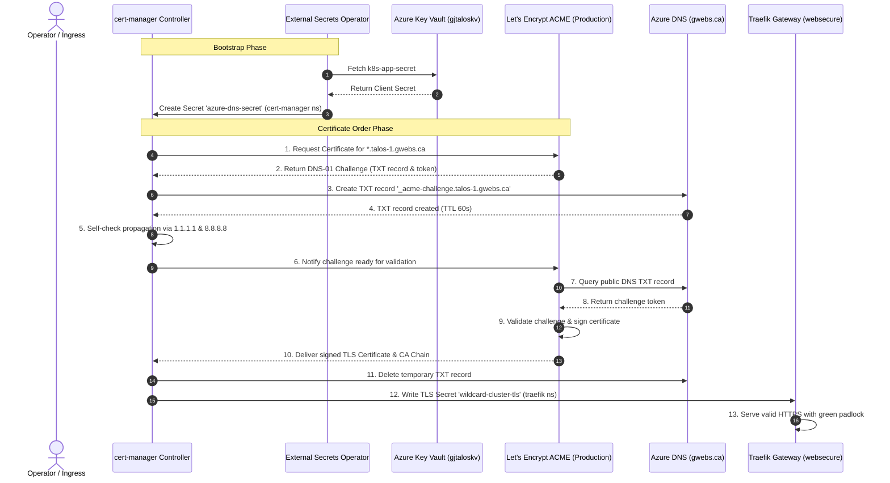

# cert-manager (Automated ACME TLS with Azure DNS)

In-cluster deployment configuration for [cert-manager](https://cert-manager.io/) in the Homelab Talos Kubernetes infrastructure.

cert-manager automates the issuance, renewal, and lifecycle management of Let's Encrypt TLS certificates across both `k8s-talos-1` and `k8s-talos-2` using **DNS-01 ACME challenges** backed by Microsoft Azure DNS.

---

## Table of Contents

- [Component Details](#component-details)
- [Directory Structure](#directory-structure)
- [Architecture: ACME DNS-01 Challenge with Azure DNS](#architecture-acme-dns-01-challenge-with-azure-dns)
- [Azure Key Vault Secrets Required](#azure-key-vault-secrets-required)
  - [1. `azure-dns-client-secret`](#1-azure-dns-client-secret)
  - [2. `azure-subscription-id`](#2-azure-subscription-id)
- [Step-by-Step Setup Runbook](#step-by-step-setup-runbook)
  - [Step 1: Add Secrets to Azure Key Vault](#step-1-add-secrets-to-azure-key-vault)
  - [Step 2: Verify Service Principal RBAC on Azure DNS](#step-2-verify-service-principal-rbac-on-azure-dns)
- [Wildcard Certificate Issuance (`*.talos-1.gwebs.ca` & `*.talos-2.gwebs.ca`)](#wildcard-certificate-issuance-talos-1gwebsca--talos-2gwebsca)
- [Traefik Gateway API Integration](#traefik-gateway-api-integration)
- [Operational Verification & Diagnostics](#operational-verification--diagnostics)
  - [1. Check cert-manager Pods](#1-check-cert-manager-pods)
  - [2. Check ClusterIssuers](#2-check-clusterissuers)
  - [3. Check Wildcard Certificate & Secret](#3-check-wildcard-certificate--secret)
  - [4. Inspect ACME Challenges & Order Status](#4-inspect-acme-challenges--order-status)
- [Troubleshooting & Resolution Guide](#troubleshooting--resolution-guide)

---

## Component Details

| Property | Value | Notes |
| :--- | :--- | :--- |
| **Project** | [cert-manager/cert-manager](https://cert-manager.io/) | Official CNCF Graduated Certificate Controller |
| **Helm Chart** | `cert-manager` (`v1.17.1`) | Repository: `https://charts.jetstack.io` |
| **Namespace** | `cert-manager` | Dedicated platform namespace |
| **Challenge Type** | ACME DNS-01 | Solved via Azure DNS API |
| **DNS Zone** | `gwebs.ca` | Hosted in Azure Resource Group `GJ-DNS-RG` |
| **Azure Service Principal**| Client ID: `e1d55ddd-3453-4a91-9842-aa7d7dc620a3` | Homelab Entra ID Application Registration (shared with OIDC) |
| **Azure Tenant ID** | `10b7061b-f2d0-4778-8cae-2666faf4af25` | Microsoft Entra ID Directory |
| **Wildcard Domains** | `*.talos-1.gwebs.ca`, `*.talos-2.gwebs.ca` | Dynamically resolved via `${CLUSTER_NAME:=talos-1}` |
| **TLS Secret Destination** | `traefik/wildcard-cluster-tls` | Bound to `traefik-gateway` HTTPS listener (port 443) |

---

## Directory Structure

```text
infrastructure/cert-manager/
├── README.md                      # Operational & architectural guide
├── namespace.yaml                 # Dedicated 'cert-manager' namespace
├── helmrepository.yaml            # Official Jetstack Helm repository
├── helmrelease.yaml               # HelmRelease (v1.17.1, recursive resolvers, CRDs enabled)
├── external-secret.yaml           # ExternalSecret syncing azure-dns-client-secret from Key Vault
├── cluster-issuer-staging.yaml    # Let's Encrypt Staging ClusterIssuer
├── cluster-issuer-prod.yaml       # Let's Encrypt Production ClusterIssuer
├── certificate.yaml               # Wildcard Certificate resource (*.${CLUSTER_NAME}.gwebs.ca)
└── kustomization.yaml             # Kustomize entrypoint bundling all manifests
```

---

## Architecture: ACME DNS-01 Challenge with Azure DNS



### Why DNS-01 Instead of HTTP-01?
1. **Wildcard Certificates**: Let's Encrypt **only** allows wildcard certificate issuance (`*.talos-1.gwebs.ca`, `*.talos-2.gwebs.ca`) via DNS-01 challenges. HTTP-01 does not support wildcards.
2. **Private & Non-Public Workloads**: Many cluster services (like Headlamp, local dashboards, and private APIs) do not have port 80 exposed directly to the public internet. DNS-01 does not require inbound HTTP traffic; it only requires outbound API calls to Azure DNS to create temporary TXT records.

---

## Azure Key Vault Secrets & Configuration

To maintain **100% zero-secrets in Git**, all credentials reside exclusively in **Azure Key Vault** (`https://gjtaloskv.vault.azure.net/`) and are fetched dynamically at runtime.

By reusing the unified Application Registration (`e1d55ddd-3453-4a91-9842-aa7d7dc620a3`), cert-manager uses the client secret **already present** in your Key Vault (`k8s-app-secret`). 

The **only secret** you need to add to Azure Key Vault is your subscription ID:

| Secret Name in Key Vault | Purpose | Where to Find Current Value | Status |
| :--- | :--- | :--- | :--- |
| **`k8s-app-secret`** | Client secret for app `e1d55ddd...` used by Headlamp (OIDC) and cert-manager (Azure DNS). | Already exists in Azure Key Vault. | **Already Configured** |
| **`azure-subscription-id`** | Azure Subscription GUID where Resource Group `GJ-DNS-RG` and DNS Zone `gwebs.ca` reside. | Azure Portal ➔ **DNS zones** ➔ `gwebs.ca` ➔ **Subscription ID** (or run `az account show --query id -o tsv`). | **Add to Key Vault** |

---

## Step-by-Step Setup Runbook

### Step 1: Add `azure-subscription-id` to Azure Key Vault

1. Open the [Azure Portal](https://portal.azure.com/).
2. Navigate to **Key Vaults** ➔ **`gjtaloskv`**.
3. Under **Objects**, select **Secrets** ➔ **+ Generate/Create**.
4. Configure Secret:
   - **Name**: `azure-subscription-id`
   - **Secret value**: Paste your Azure Subscription ID GUID (e.g. `xxxxxxxx-xxxx-xxxx-xxxx-xxxxxxxxxxxx`).
   - Click **Create**.

### Step 2: Grant Azure DNS Permissions to the OIDC App

In the Azure Portal, grant the OIDC Application Registration (`e1d55ddd-3453-4a91-9842-aa7d7dc620a3`) permissions to manage DNS records:

1. In the Azure Portal, navigate to **DNS zones** ➔ **`gwebs.ca`**.
2. Select **Access control (IAM)** ➔ **+ Add** ➔ **Add role assignment**.
3. Select role: **`DNS Zone Contributor`**.
4. Assign access to **User, group, or service principal** ➔ select app registration `e1d55ddd-3453-4a91-9842-aa7d7dc620a3`.
5. Click **Review + assign**.
6. Navigate to **Resource groups** ➔ **`GJ-DNS-RG`** ➔ **Access control (IAM)** ➔ **+ Add role assignment**.
7. Assign role **`Reader`** to app registration `e1d55ddd-3453-4a91-9842-aa7d7dc620a3` (required by Azure Resource Manager API to locate the DNS zone).

---

## Wildcard Certificate Issuance (`*.talos-1.gwebs.ca` & `*.talos-2.gwebs.ca`)

The [`certificate.yaml`](certificate.yaml) manifest uses Flux's dynamic variable substitution:

```yaml
apiVersion: cert-manager.io/v1
kind: Certificate
metadata:
  name: wildcard-cluster-cert
  namespace: traefik
spec:
  secretName: wildcard-cluster-tls
  issuerRef:
    name: letsencrypt-prod
    kind: ClusterIssuer
  dnsNames:
    - "${CLUSTER_NAME:=talos-1}.gwebs.ca"
    - "*.${CLUSTER_NAME:=talos-1}.gwebs.ca"
```

- On **`k8s-talos-1`**: Issues a single wildcard certificate covering `talos-1.gwebs.ca` and `*.talos-1.gwebs.ca`.
- On **`k8s-talos-2`**: Issues a single wildcard certificate covering `talos-2.gwebs.ca` and `*.talos-2.gwebs.ca`.
- **Zero Configuration Drift**: The same declarative file serves both clusters without duplicating code or certificates.

---

## Traefik Gateway API Integration

In [`infrastructure/traefik/helmrelease.yaml`](../traefik/helmrelease.yaml), the `websecure` (port 443) listener attaches to `wildcard-cluster-tls`:

```yaml
gateway:
  enabled: true
  listeners:
    websecure:
      port: 8443
      protocol: HTTPS
      certificateRefs:
        - name: wildcard-cluster-tls
        - name: traefik-default-cert
      namespacePolicy:
        from: All
```

### Automatic TLS for All Ingress Routes
Because `certificateRefs` is defined at the **Gateway level**, any `HTTPRoute` created across the cluster (e.g., `headlamp.talos-1.gwebs.ca`, `traefik.talos-1.gwebs.ca`, `stirling-pdf.talos-1.gwebs.ca`) automatically inherits trusted HTTPS without needing individual certificate annotations.

---

## Operational Verification & Diagnostics

### 1. Check cert-manager Pods
```bash
kubectl get pods -n cert-manager
```
Expected output:
```text
NAME                                       READY   STATUS    RESTARTS   AGE
cert-manager-79f97d86f8-4z9kq             1/1     Running   0          2m
cert-manager-cainjector-7d48895995-l9dkh   1/1     Running   0          2m
cert-manager-webhook-68df6d98c6-h97sc      1/1     Running   0          2m
```

### 2. Check ClusterIssuers
```bash
kubectl get clusterissuers
```
Expected output:
```text
NAME                  READY   AGE
letsencrypt-staging   True    2m
letsencrypt-prod      True    2m
```

### 3. Check Wildcard Certificate & Secret
```bash
# Check certificate status
kubectl get certificate -n traefik wildcard-cluster-cert

# Check the generated TLS secret
kubectl get secret -n traefik wildcard-cluster-tls
```
Expected output once issued:
```text
NAME                    READY   SECRET                 AGE
wildcard-cluster-cert   True    wildcard-cluster-tls   2m
```

### 4. Inspect ACME Challenges & Order Status
```bash
# View active challenge status
kubectl get challenges -A

# View active order status
kubectl get orders -A

# View detailed issuance events
kubectl describe certificate -n traefik wildcard-cluster-cert
```

---

## Troubleshooting & Resolution Guide

### 1. `ClusterIssuer` Not Ready: `Failed to determine Azure environment` / `subscriptionID required`
- **Symptom**: `kubectl describe clusterissuer letsencrypt-prod` shows `Ready=False` with error mentioning subscription or credentials.
- **Root Cause**: `${AZURE_SUBSCRIPTION_ID}` was not substituted by Flux because the secret `azure-subscription-id` is missing in Azure Key Vault.
- **Fix**: Add `azure-subscription-id` to Azure Key Vault `gjtaloskv`. Then force-sync ESO:
  ```bash
  kubectl annotate externalsecret -n flux-system cluster-secrets force-sync=$(date +%s) --overwrite
  ```

### 2. `Challenge` Fails: `DNS-01 self-check failed for _acme-challenge`
- **Symptom**: Certificate remains `Ready=False` and challenge displays `Waiting for DNS-01 challenge propagation`.
- **Root Cause**: Split-horizon DNS on local LAN returned an internal IP or NXDOMAIN instead of Azure DNS.
- **Fix**: Verify that `helmrelease.yaml` passes `--dns01-recursive-nameservers=1.1.1.1:53,8.8.8.8:53` and `--dns01-recursive-nameservers-only` to force external recursive validation.

### 3. `Failed to exchange secret` / `InvalidClientSecret`
- **Symptom**: Challenge logs show `AADSTS7000215: Invalid client secret provided`.
- **Root Cause**: The client secret in Key Vault secret `azure-dns-client-secret` does not match the Service Principal credentials in Azure AD.
- **Fix**: Copy the current `AZURE_SECRET` from `Docker/dns-update/.env` and update `azure-dns-client-secret` in Key Vault.

