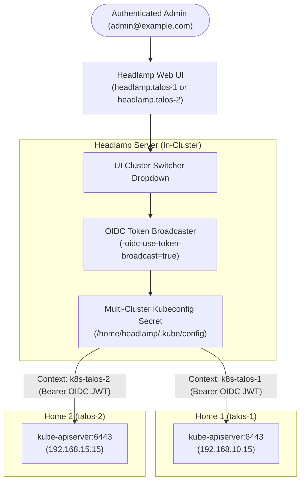
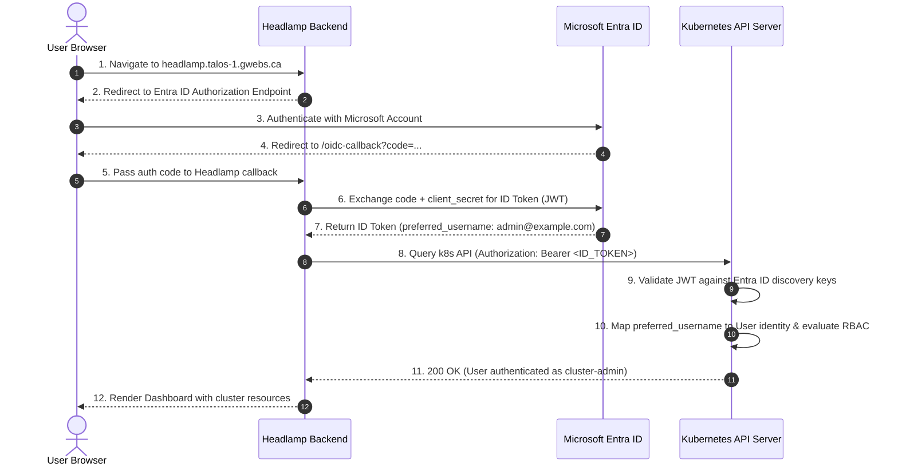

# Headlamp Kubernetes Dashboard

In-cluster deployment configuration for [Headlamp](https://github.com/kubernetes-sigs/headlamp) (official Kubernetes SIG UI) in the Homelab Talos Kubernetes infrastructure.

Headlamp provides a clean, extensible, multi-cluster web dashboard for monitoring workloads, viewing live pod logs and metrics, inspecting events, and managing Kubernetes resources across the clusters.

---

## Table of Contents

- [Component Details](#component-details)
- [Directory Structure](#directory-structure)
- [Architecture: End-to-End OIDC SSO](#architecture-end-to-end-oidc-sso)
- [Microsoft Entra ID (Azure AD) SSO Configuration](#microsoft-entra-id-azure-ad-sso-configuration)
  - [Azure App Registration Parameters](#azure-app-registration-parameters)
  - [Step-by-Step Azure Portal Setup](#step-by-step-azure-portal-setup)
- [Control Plane Structured Authentication (`KubeAuthenticationConfig`)](#control-plane-structured-authentication-kubeauthenticationconfig)
- [Workload Identity Federation & Azure Key Vault](#workload-identity-federation--azure-key-vault)
- [Cluster RBAC Access](#cluster-rbac-access)
  - [Retrieving the Breakglass Token](#retrieving-the-breakglass-token)
- [Troubleshooting & Resolution Guide](#troubleshooting--resolution-guide)

---

## Component Details

| Property | Value | Notes |
| :--- | :--- | :--- |
| **Project** | [kubernetes-sigs/headlamp](https://github.com/kubernetes-sigs/headlamp) | Official Kubernetes SIG UI dashboard |
| **Helm Chart** | `headlamp` (`0.46.0`) | Repository: `https://kubernetes-sigs.github.io/headlamp/` |
| **App Version** | `v0.46.0` | Latest stable release |
| **Container Image** | `ghcr.io/headlamp-k8s/headlamp:v0.46.0` | Multi-arch Linux container image |
| **Flux Plugin Image** | `ghcr.io/headlamp-k8s/headlamp-plugin-flux:v0.7.0` | Pre-loaded via initContainer |
| **Namespace** | `headlamp` | Dedicated platform namespace |
| **Routing** | `headlamp.${CLUSTER_NAME}.gwebs.ca` | Kubernetes Gateway API `HTTPRoute` attached to `traefik-gateway` |
| **Authentication** | Microsoft Entra ID (Azure AD) OIDC SSO | With `headlamp-breakglass` ServiceAccount fallback token |

---

## Directory Structure

```text
infrastructure/headlamp/
├── README.md                      # Documentation & operational guide
├── namespace.yaml                 # Dedicated 'headlamp' namespace
├── helmrepository.yaml            # Official Headlamp Helm repository
├── helmrelease.yaml               # Headlamp HelmRelease (v0.46.0, Flux plugin, Gateway API, OIDC)
├── external-secret.yaml           # ExternalSecret syncing client secret & templating multi-cluster kubeconfig
├── oidc-rbac.yaml                 # ClusterRoleBinding granting cluster-admin to Entra ID users
├── rbac-admin.yaml                # Emergency breakglass ServiceAccount & static token
└── kustomization.yaml             # Kustomize entrypoint bundling all manifests
```

---

## Multi-Cluster Management & Token Broadcasting

Both Headlamp deployments are configured to manage both `k8s-talos-1` and `k8s-talos-2` from a single pane of glass:



### How Multi-Cluster Federation Works:

1. **Templated Multi-Cluster Kubeconfig**:
   [`external-secret.yaml`](external-secret.yaml) defines contexts for both `k8s-talos-1` (`https://192.168.10.15:6443`) and `k8s-talos-2` (`https://192.168.15.15:6443`) with their respective cluster root CA certificates. Crucially, the External Secrets Operator injects `client-secret` into the auth-provider configuration directly from Azure Key Vault at runtime, maintaining 100% zero-secrets in Git while allowing OAuth2 authorization code exchange and token refresh across both clusters.
2. **Dynamic Default Context**:
   `current-context: k8s-${CLUSTER_NAME:=talos-1}` defaults to the local cluster where that specific Headlamp instance is deployed, but both clusters are always registered and active.
3. **OIDC Token Broadcasting (`-oidc-use-token-broadcast=true`)**:
   Because both clusters share the exact same Microsoft Entra ID tenant and client ID:
   - When you log in with your Microsoft account on `https://headlamp.talos-1.gwebs.ca`, Headlamp automatically broadcasts the authentication cookie to both cluster contexts.
   - You can toggle between `k8s-talos-1` and `k8s-talos-2` directly in the top-left cluster dropdown in Headlamp without logging in twice or re-authenticating.
   - The same seamless experience applies if you access `https://headlamp.talos-2.gwebs.ca`.

## Architecture: End-to-End OIDC SSO

Headlamp OIDC authentication consists of two coordinated phases:



1. **Dashboard OIDC Flow (Steps 1–7)**:
   Managed by the Headlamp container using environment variables (`OIDC_CLIENT_ID`, `OIDC_ISSUER_URL`, `OIDC_SCOPES`, `OIDC_CALLBACK_URL`) and the secret `OIDC_CLIENT_SECRET`.
2. **Cluster API Server Validation (Steps 8–11)**:
   The Kubernetes API server itself must trust and validate the incoming bearer token. In Talos v1.14+, this is configured via `KubeAuthenticationConfig` (Kubernetes Structured Authentication).

---

## Microsoft Entra ID (Azure AD) SSO Configuration

### Azure App Registration Parameters

- **Application (client) ID**: `e1d55ddd-3453-4a91-9842-aa7d7dc620a3`
- **Object ID**: `bff2982d-ebce-4ded-8ddd-527d9a2193bd`
- **Directory (tenant) ID**: `10b7061b-f2d0-4778-8cae-2666faf4af25`
- **Issuer URL**: `https://login.microsoftonline.com/10b7061b-f2d0-4778-8cae-2666faf4af25/v2.0`

### Step-by-Step Azure Portal Setup

1. **Authentication (Redirect URIs)**:
   - Navigate to **Microsoft Entra ID** > **App registrations** > select the Headlamp app (`e1d55ddd-3453-4a91-9842-aa7d7dc620a3`).
   - Under **Manage**, select **Authentication**.
   - Under **Platform configurations**, select or add **Web**.
   - Configure the following **Redirect URIs**:
     - `https://headlamp.talos-1.gwebs.ca/oidc-callback`
     - `https://headlamp.talos-2.gwebs.ca/oidc-callback`
   - Under **Implicit grant and hybrid flows**, enable **ID tokens (used for implicit and hybrid flows)**.
   - Click **Save**.

2. **Certificates & Secrets (Azure Key Vault)**:
   - Under **Manage**, select **Certificates & secrets** > **Client secrets**.
   - Create a client secret (valid until October 23, 2028).
   - Store the secret directly in Azure Key Vault (`https://gjtaloskv.vault.azure.net/`) under:
     - **Secret Name**: `headlamp-oidc-client-secret`
     - **Value**: `<Azure Client Secret Value>`
   - The External Secrets Operator automatically synchronizes it into Kubernetes Secret `headlamp-oidc` (`OIDC_CLIENT_SECRET`). No secrets are committed to Git.

3. **API Permissions**:
   - Under **Manage**, select **API permissions**.
   - Add the following Microsoft Graph delegated permissions:
     - `openid`
     - `profile`
     - `email`
     - `offline_access`
   - Click **Grant admin consent for <Tenant>**.

4. **Token Configuration**:
   - Under **Manage**, select **Token configuration**.
   - Add Optional Claims for **ID tokens**:
     - `email`, `preferred_username`
   - Add groups claim: **Security groups**.

---

## Control Plane Structured Authentication (`KubeAuthenticationConfig`)

Talos v1.14+ manages API server authentication through modular `KubeAuthenticationConfig` documents rather than legacy `--oidc-*` CLI flags.

Configured in [`K8s/Omni/clusters/patches/oidc-azure-ad.yaml`](../../Omni/clusters/patches/oidc-azure-ad.yaml):

```yaml
apiVersion: v1alpha1
kind: KubeAuthenticationConfig
configuration:
  apiVersion: apiserver.config.k8s.io/v1beta1
  kind: AuthenticationConfiguration
  jwt:
    - issuer:
        url: https://login.microsoftonline.com/10b7061b-f2d0-4778-8cae-2666faf4af25/v2.0
        audiences:
          - e1d55ddd-3453-4a91-9842-aa7d7dc620a3
      claimMappings:
        username:
          claim: preferred_username
          prefix: ""
```

### Critical Implementation Rules:
1. **Audiences Nesting**: `audiences` **must** be nested under `jwt[].issuer.audiences`. Placing `audiences` at the root of `jwt[]` triggers a fatal `strict decoding error: unknown field "jwt[0].audiences"`.
2. **Anonymous Auth Exclusivity**: Do **not** include an `anonymous:` block in `AuthenticationConfiguration`. The file-based anonymous block is mutually exclusive with the `--anonymous-auth` CLI flag passed by Talos's static pod generator.
3. **Claim Mapping**: Using `claim: preferred_username` ensures consistent mapping for both personal Microsoft accounts (`@outlook.com`) and enterprise UPNs without triggering Kubernetes' CEL `email_verified` validation requirements.

---

## Workload Identity Federation & Azure Key Vault

Headlamp's OIDC credentials and administrator identity are decoupled from Git using the [External Secrets Operator](../external-secrets/README.md) and Microsoft Entra Workload Identity Federation:

1. **Headlamp Backend Token Exchange**:
   When Microsoft redirects to `/oidc-callback`, the backend completes the token exchange using `OIDC_CLIENT_SECRET`, injected from Secret `headlamp-oidc` synced from Azure Key Vault by ESO.

2. **Zero-Secret Administrator RBAC**:
   The admin user's identity is stored in Azure Key Vault secret `headlamp-admin-email`. ESO synchronizes this into Secret `flux-system/cluster-secrets`. Flux CD uses `postBuild.substituteFrom` to dynamically populate `${OIDC_ADMIN_EMAIL}` into `oidc-rbac.yaml`, ensuring that personal email addresses remain 100% confidential in Git.

---

## Cluster RBAC Access

Permissions are granted using Kubernetes `ClusterRoleBinding` resources:

- **OIDC Administrator Binding** ([`oidc-rbac.yaml`](oidc-rbac.yaml)):
  Grants `cluster-admin` to the Entra ID user identity injected at runtime via `${OIDC_ADMIN_EMAIL}`.
- **Kubelet-to-API Server Binding** ([`system-rbac/apiserver-kubelet.yaml`](../system-rbac/apiserver-kubelet.yaml)):
  Binds `apiserver-kubelet-client` to `system:kubelet-api-admin` for kubelet webhook authorization.
- **Emergency Breakglass Binding** ([`rbac-admin.yaml`](rbac-admin.yaml)):
  Provides a static ServiceAccount `headlamp-breakglass` and Secret `headlamp-breakglass-token` for emergency cluster recovery when OIDC or external internet is unavailable.

### Retrieving the Breakglass Token

If OIDC is ever offline, log in with the breakglass token:

```bash
kubectl get secret -n headlamp headlamp-breakglass-token -o jsonpath='{.data.token}' | base64 --decode
echo ""
```
Paste this token into the Headlamp login page to regain full administrative control.

---

## Troubleshooting & Resolution Guide

### 1. `AADSTS90102: 'redirect_uri' value must be a valid absolute URI.`

- **Symptom**: Microsoft sign-in page displays error `AADSTS90102`.
- **Root Cause**: The Headlamp Helm chart passes `-oidc-callback-url=$(OIDC_CALLBACK_URL)` in container args. If `OIDC_CALLBACK_URL` is omitted from `env:`, Kubernetes cannot resolve the variable, passing the literal string `"$(OIDC_CALLBACK_URL)"` as the redirect URI.
- **Fix**: Declare `OIDC_CALLBACK_URL` under `env:` in `helmrelease.yaml`:
  ```yaml
  env:
    - name: OIDC_CALLBACK_URL
      value: "https://headlamp.${CLUSTER_NAME:=talos-1}.gwebs.ca/oidc-callback"
  ```

### 2. `Authentication: The cluster did not accept your sign-in.`

- **Symptom**: After authenticating on Microsoft, Headlamp displays:
  > *"The cluster did not accept your sign-in. Its API server may not trust this OIDC provider (issuer, client ID, or audience)..."*
- **Root Cause**: Entra ID issued the ID token, but the Kubernetes API server had no OIDC provider configured and returned `401 Unauthorized` when Headlamp presented the bearer token.
- **Fix**: Attach `patches/oidc-azure-ad.yaml` (`KubeAuthenticationConfig`) to the cluster templates in `K8s/Omni/clusters/` and run `omnictl cluster template sync`.

### 3. `proxy error` / `502 Bad Gateway` After Applying OIDC Patch

- **Symptom**: `kubectl get nodes` returns `an error on the server ("proxy error") has prevented the request from succeeding`.
- **Root Cause**: The API server static pod manifest was rendered with an invalid `AuthenticationConfiguration` schema (e.g. `audiences` improperly nested outside `issuer`, or an invalid CEL expression requiring `email_verified`). The static pod failed to start, taking down the Omni proxy.
- **Fix**: Verify the configuration schema against `registry.k8s.io/kube-apiserver:v1.37.1` in Docker. Ensure `audiences` is nested under `issuer:`, and allow ~60 seconds for Talos static pod recreation to complete.
