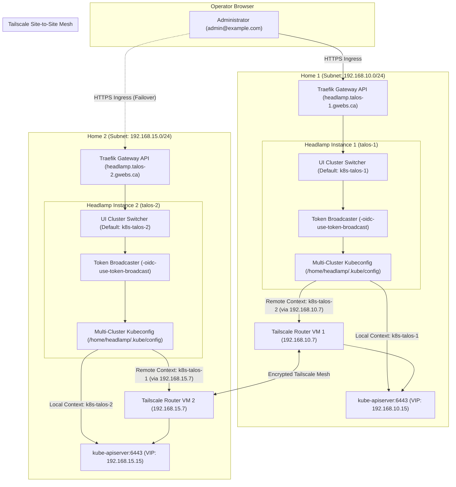
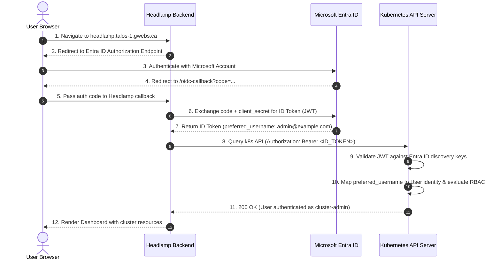

# Headlamp Kubernetes Dashboard

In-cluster deployment configuration for [Headlamp](https://github.com/kubernetes-sigs/headlamp) (official Kubernetes SIG UI) in the Homelab Talos Kubernetes infrastructure.

Headlamp provides a clean, extensible, multi-cluster web dashboard for monitoring workloads, viewing live pod logs and metrics, inspecting events, and managing Kubernetes resources across the clusters.

---

## Table of Contents

- [Component Details](#component-details)
- [Directory Structure](#directory-structure)
- [Multi-Cluster Setup & Federation Architecture](#multi-cluster-setup--federation-architecture)
  - [Single Pane of Glass Topology](#single-pane-of-glass-topology)
  - [Dual-Cluster High Availability & Resilience](#dual-cluster-high-availability--resilience)
  - [Zero-Secret Templated Kubeconfig (External Secrets Operator)](#zero-secret-templated-kubeconfig-external-secrets-operator)
  - [In-Cluster Context Alignment & Duplicate Context Elimination](#in-cluster-context-alignment--duplicate-context-elimination)
  - [Cross-Cluster OIDC Token Broadcasting](#cross-cluster-oidc-token-broadcasting)
  - [Cross-Cluster Network Routing & Tailscale Site-to-Site](#cross-cluster-network-routing--tailscale-site-to-site)
  - [Multi-Cluster Flux CD Plugin Integration](#multi-cluster-flux-cd-plugin-integration)
  - [Multi-Cluster Operational Verification](#multi-cluster-operational-verification)
- [Architecture: End-to-End OIDC SSO](#architecture-end-to-end-oidc-sso)
- [Microsoft Entra ID (Azure AD) SSO Configuration](#microsoft-entra-id-azure-ad-sso-configuration)
  - [Azure App Registration Parameters](#azure-app-registration-parameters)
  - [Step-by-Step Azure Portal Setup](#step-by-step-azure-portal-setup)
- [Control Plane Structured Authentication (`KubeAuthenticationConfig`)](#control-plane-structured-authentication-kubeauthenticationconfig)
- [Workload Identity Federation & Azure Key Vault](#workload-identity-federation--azure-key-vault)
- [Cluster RBAC Access](#cluster-rbac-access)
  - [Retrieving the Breakglass Token](#retrieving-the-breakglass-token)
- [Troubleshooting & Resolution Guide](#troubleshooting--resolution-guide)
  - [1. `AADSTS90102`: Invalid Redirect URI](#1-aadsts90102-redirect_uri-value-must-be-a-valid-absolute-uri)
  - [2. Authentication: The cluster did not accept your sign-in](#2-authentication-the-cluster-did-not-accept-your-sign-in)
  - [3. `proxy error` / `502 Bad Gateway` After Applying OIDC Patch](#3-proxy-error--502-bad-gateway-after-applying-oidc-patch)
  - [4. `AADSTS7000218`: Missing `client_assertion` or `client_secret`](#4-aadsts7000218-the-request-body-must-contain-client_assertion-or-client_secret)
  - [5. Cross-Cluster Communication Timeout / Remote Cluster Unavailable](#5-cross-cluster-communication-timeout--remote-cluster-unavailable)
  - [6. Duplicate or Redundant `main` Cluster in Switcher](#6-duplicate-or-redundant-main-cluster-in-switcher)
- [Security Posture & Hardening Verification](#security-posture--hardening-verification)

---

## Component Details

| Property | Value | Notes |
| :--- | :--- | :--- |
| **Project** | [kubernetes-sigs/headlamp](https://github.com/kubernetes-sigs/headlamp) | Official Kubernetes SIG UI dashboard |
| **Helm Chart** | `headlamp` (`0.46.0`) | Repository: `https://kubernetes-sigs.github.io/headlamp/` |
| **App Version** | `v0.46.0` | Latest stable release |
| **Container Image** | `ghcr.io/headlamp-k8s/headlamp:v0.46.0` | Multi-arch Linux container image |
| **Flux Plugin Image** | `ghcr.io/headlamp-k8s/headlamp-plugin-flux:v0.7.0` | Pre-loaded via initContainer |
| **Namespace** | `headlamp` | Dedicated platform namespace |
| **Routing** | `headlamp.${CLUSTER_NAME}.gwebs.ca` | Kubernetes Gateway API `HTTPRoute` attached to `traefik-gateway` |
| **Authentication** | Microsoft Entra ID (Azure AD) OIDC SSO | With `headlamp-breakglass` ServiceAccount fallback token |

---

## Directory Structure

```text
infrastructure/headlamp/
├── README.md                      # Documentation & operational guide
├── namespace.yaml                 # Dedicated 'headlamp' namespace
├── helmrepository.yaml            # Official Headlamp Helm repository
├── helmrelease.yaml               # Headlamp HelmRelease (v0.46.0, Flux plugin, Gateway API, OIDC)
├── external-secret.yaml           # ExternalSecret syncing client secret & templating multi-cluster kubeconfig
├── oidc-rbac.yaml                 # ClusterRoleBinding granting cluster-admin to Entra ID users
├── rbac-admin.yaml                # Emergency breakglass ServiceAccount & static token
└── kustomization.yaml             # Kustomize entrypoint bundling all manifests
```

---

## Multi-Cluster Setup & Federation Architecture

Both homelab Kubernetes clusters (`k8s-talos-1` and `k8s-talos-2`) run independent, autonomous Headlamp deployments configured for bidirectional cross-cluster management and single sign-on from a single pane of glass.

### Single Pane of Glass Topology

An administrator can access Headlamp from either site URL:
- **Home 1**: `https://headlamp.talos-1.gwebs.ca`
- **Home 2**: `https://headlamp.talos-2.gwebs.ca`

From either dashboard, the operator can switch dynamically between both clusters using the top-left cluster switcher without re-authenticating.



### Dual-Cluster High Availability & Resilience

- **Autonomous Local Execution**: Each cluster operates its own local Headlamp pod, Traefik Gateway API `HTTPRoute`, and ExternalSecret synchronization. Neither cluster relies on the other to keep its own local dashboard online.
- **Failover Survivability**: If Home 1 suffers an ISP or hardware outage, the operator can immediately access `https://headlamp.talos-2.gwebs.ca` to monitor and manage Home 2 workloads.
- **Disaster Triage**: When both sites are online, an administrator connected to Home 1 can triage, restart, or inspect workloads in Home 2 over the Tailscale site-to-site mesh without switching browser windows or authenticating twice.

---

### Zero-Secret Templated Kubeconfig (External Secrets Operator)

Headlamp loads all managed clusters from a secret volume mounted at `/home/headlamp/.kube/config`. To adhere strictly to GitOps zero-secrets principles, the kubeconfig is generated dynamically at runtime by the External Secrets Operator:

1. **Source of Truth**: The client secret is stored securely in Azure Key Vault (`k8s-app-secret`) and accessed via passwordless Workload Identity Federation.
2. **Dynamic In-Memory Templating**: In [`external-secret.yaml`](external-secret.yaml), ESO's Template Engine v2 renders the complete multi-cluster kubeconfig with `insecure-skip-tls-verify: true` (transit traffic is already end-to-end encrypted across private Tailscale WireGuard tunnels):
   ```yaml
   apiVersion: v1
   kind: Config
   clusters:
     - name: k8s-talos-1
       cluster:
         server: https://192.168.10.15:6443
         insecure-skip-tls-verify: true
     - name: k8s-talos-2
       cluster:
         server: https://192.168.15.15:6443
         insecure-skip-tls-verify: true
   contexts:
     - name: k8s-talos-1
       context:
         cluster: k8s-talos-1
         user: oidc
     - name: k8s-talos-2
       context:
         cluster: k8s-talos-2
         user: oidc
   current-context: k8s-${CLUSTER_NAME:=talos-1}
   users:
     - name: oidc
       user:
         auth-provider:
           name: oidc
           config:
             idp-issuer-url: "https://login.microsoftonline.com/10b7061b-f2d0-4778-8cae-2666faf4af25/v2.0"
             client-id: "e1d55ddd-3453-4a91-9842-aa7d7dc620a3"
             client-secret: "{{ .OIDC_CLIENT_SECRET }}"
             scope: "openid,profile,email,offline_access"
   ```
3. **Prevention of `AADSTS7000218`**: Microsoft Entra ID Web applications are confidential clients. When Headlamp attempts background token refresh or authorization code redemption for kubeconfig contexts, it requires `client-secret` within `users[].user.auth-provider.config`. Templating the secret via ESO provides the required credentials without committing any secrets to Git.
4. **Dynamic Context Resolution**: Flux CD substitutes `${CLUSTER_NAME}` at deployment time (`talos-1` on cluster 1, `talos-2` on cluster 2). This ensures that each Headlamp pod defaults to its local cluster while retaining the remote cluster in its context registry.

---

### In-Cluster Context Alignment & Duplicate Context Elimination

When Headlamp runs in Kubernetes, its default behavior is to auto-detect the in-cluster environment via `/var/run/secrets/kubernetes.io/serviceaccount` and register a context called `main`.

In a multi-cluster setup with an external kubeconfig, this results in:
- A confusing third cluster named `main` in the UI switcher.
- Privilege discrepancies: `main` authenticates via the pod's limited ServiceAccount rather than the administrator's OIDC credentials.

#### Resolution in [`helmrelease.yaml`](helmrelease.yaml):
```yaml
config:
  inCluster: true
  inClusterContextName: "k8s-${CLUSTER_NAME:=talos-1}"
```

By explicitly declaring `inClusterContextName: "k8s-${CLUSTER_NAME:=talos-1}"`:
1. Headlamp associates the in-cluster pod identity directly with the matching kubeconfig context (`k8s-talos-1` on cluster 1, `k8s-talos-2` on cluster 2).
2. The phantom `main` entry is eliminated from the cluster dropdown.
3. Both clusters in the UI are cleanly named and use consistent OIDC authentication.

---

### Cross-Cluster OIDC Token Broadcasting

Headlamp includes native token broadcasting functionality configured via:
- Container flag: `-oidc-use-token-broadcast=true`
- Environment variable: `HEADLAMP_CONFIG_OIDC_USE_TOKEN_BROADCAST: "true"`
- Helm config: `oidc.useTokenBroadcast: true`

#### How Token Broadcasting Works Under the Hood:
1. **Initial Login**: The administrator navigates to `https://headlamp.talos-1.gwebs.ca` and authenticates against Microsoft Entra ID. Headlamp stores the validated ID token and refresh token in an encrypted, HTTP-only session cookie.
2. **Context Evaluation**: When the user switches from `k8s-talos-1` to `k8s-talos-2` in the cluster switcher, Headlamp's token broadcaster inspects the target cluster configuration in `/home/headlamp/.kube/config`.
3. **Issuer & Audience Validation**: Token broadcasting strictly verifies that the destination cluster's `idp-issuer-url` and `client-id` match the session issuer and client ID.
4. **Cookie Replication**: Because both clusters share:
   - Identical Entra ID Tenant ID (`10b7061b-f2d0-4778-8cae-2666faf4af25`),
   - Identical Client Application ID (`e1d55ddd-3453-4a91-9842-aa7d7dc620a3`), and
   - Identical Talos `KubeAuthenticationConfig` (Structured Authentication),
   Headlamp broadcasts the Bearer JWT directly to `192.168.15.15:6443`.
5. **Zero Friction UX**: The administrator gains immediate administrative access to `k8s-talos-2` without logging in a second time or completing an extra MFA challenge.

---

### Cross-Cluster Network Routing & Tailscale Site-to-Site

All cross-cluster API communications occur exclusively over private network infrastructure routed through dedicated Tailscale subnet router VMs on each site:

| Cluster | Local Subnet | Control Plane VIP | Local Tailscale Gateway | Routing Enforcement |
| :--- | :--- | :--- | :--- | :--- |
| **`k8s-talos-1`** | `192.168.10.0/24` (Home 1) | `https://192.168.10.15:6443` | `192.168.10.7` (TS Router VM 1) | Talos [`routes-talos-1.yaml`](../../Omni/clusters/patches/routes-talos-1.yaml) & DHCP Opt 121 |
| **`k8s-talos-2`** | `192.168.15.0/24` (Home 2) | `https://192.168.15.15:6443` | `192.168.15.7` (TS Router VM 2) | Talos [`routes-talos-2.yaml`](../../Omni/clusters/patches/routes-talos-2.yaml) & DHCP Opt 121 |

#### Routing & Transit Architecture:
1. **Dedicated Tailscale Router VMs**:
   - Each site hosts a dedicated Tailscale subnet router VM (`192.168.10.7` on Home 1, `192.168.15.7` on Home 2) provisioned via Ansible ([`tailscale-routers.yml`](../../../Ansible/playbooks/tailscale-routers.yml)).
   - Subnet routers advertise their local LAN (`--advertise-routes=192.168.10.0/24` and `--advertise-routes=192.168.15.0/24`) and accept remote subnet routes (`--accept-routes`).
   - Router VMs enable IP forwarding (`net.ipv4.ip_forward=1`), disable `rp_filter`, and configure TCP MSS clamping (`--clamp-mss-to-pmtu`) on `tailscale0` to prevent fragmentation over WAN links.

2. **Talos Static Routing**:
   - Talos nodes cannot rely on DHCP option updates for critical control plane traffic. Instead, each node has an explicit network interface route patch applied via Omni:
     - On `k8s-talos-1` nodes: route to `192.168.15.0/24` via gateway `192.168.10.7`.
     - On `k8s-talos-2` nodes: route to `192.168.10.0/24` via gateway `192.168.15.7`.

3. **DHCP Option 121 (Classless Static Routes)**:
   - Residential routers / DHCP servers at each home broadcast DHCP Option 121 to assign static routes for the remote subnet:
     - Site 1 DHCP clients receive: `192.168.15.0/24` via gateway `192.168.10.7`.
     - Site 2 DHCP clients receive: `192.168.10.0/24` via gateway `192.168.15.7`.
   - This allows any administrator laptop, workstation, or server on the local network to reach the remote cluster's API VIP without running a local Tailscale client.

#### Network Security Safeguards:
- **Zero Public Exposure**: Neither cluster's `kube-apiserver` (port 6443) is exposed to the public internet, public DNS, or WAN port forwarding.
- **End-to-End Encrypted Tailscale Transit**: Traffic between `192.168.10.7` and `192.168.15.7` is authenticated and encrypted end-to-end via Tailscale's encrypted WireGuard-based mesh protocol.
- **Cryptographic Trust**: Each cluster's root CA certificate is embedded directly into the kubeconfig (`certificate-authority-data`), guaranteeing strict TLS mutual verification and preventing man-in-the-middle attacks across the inter-site link.

---

### Multi-Cluster Flux CD Plugin Integration

The official Headlamp Flux plugin (`headlamp-plugin-flux:v0.7.0`) is pre-loaded into the dashboard pod via an initContainer:

```yaml
initContainers:
  - name: install-flux-plugin
    image: ghcr.io/headlamp-k8s/headlamp-plugin-flux:v0.7.0
    command: ["/bin/sh", "-c"]
    args:
      - mkdir -p /headlamp/plugins && cp -r /plugins/* /headlamp/plugins/
    volumeMounts:
      - name: plugins-dir
        mountPath: /headlamp/plugins
```

#### Multi-Cluster Behavior:
- **Dynamic CRD Discovery**: When switching between `k8s-talos-1` and `k8s-talos-2`, the Flux UI tab dynamically switches its API queries to the active cluster.
- **Unified GitOps Control**: Operators can monitor Kustomization reconciliation states, inspect HelmRelease conditions, and trigger manual reconciliations on either cluster from a single dashboard interface.

---

### Multi-Cluster Operational Verification

Run the following commands to verify multi-cluster setup and health:

#### 1. Verify Templated Kubeconfig on Both Clusters
```bash
# Check that the ExternalSecret synced successfully
kubectl --context admin@k8s-talos-1 -n headlamp get externalsecret headlamp-oidc
kubectl --context admin@k8s-talos-2 -n headlamp get externalsecret headlamp-oidc

# Verify the rendered kubeconfig secret contains both contexts
kubectl --context admin@k8s-talos-1 -n headlamp get secret headlamp-oidc -o jsonpath='{.data.config}' | base64 -d | grep "name: k8s-talos"
```

#### 2. Verify In-Pod Cross-Cluster Connectivity
```bash
# From Cluster 1 Headlamp pod: test connectivity to Cluster 2 API server VIP
kubectl --context admin@k8s-talos-1 -n headlamp exec deploy/headlamp -- nc -zv 192.168.15.15 6443

# From Cluster 2 Headlamp pod: test connectivity to Cluster 1 API server VIP
kubectl --context admin@k8s-talos-2 -n headlamp exec deploy/headlamp -- nc -zv 192.168.10.15 6443
```

#### 3. Verify UI Federation and Token Broadcasting
1. Open `https://headlamp.talos-1.gwebs.ca` in your browser.
2. Sign in using your Microsoft Entra ID administrator credentials.
3. Verify that the current context displays `k8s-talos-1`.
4. In the top-left cluster dropdown, click `k8s-talos-2`.
5. Confirm that workloads, nodes, and the Flux tab for `k8s-talos-2` load instantly without any re-login prompts.

---

## Architecture: End-to-End OIDC SSO

Headlamp OIDC authentication consists of two coordinated phases:



1. **Dashboard OIDC Flow (Steps 1–7)**:
   Managed by the Headlamp container using environment variables (`OIDC_CLIENT_ID`, `OIDC_ISSUER_URL`, `OIDC_SCOPES`, `OIDC_CALLBACK_URL`) and the secret `OIDC_CLIENT_SECRET`.
2. **Cluster API Server Validation (Steps 8–11)**:
   The Kubernetes API server itself must trust and validate the incoming bearer token. In Talos v1.14+, this is configured via `KubeAuthenticationConfig` (Kubernetes Structured Authentication).

---

## Microsoft Entra ID (Azure AD) SSO Configuration

### Azure App Registration Parameters

- **Application (client) ID**: `e1d55ddd-3453-4a91-9842-aa7d7dc620a3`
- **Object ID**: `bff2982d-ebce-4ded-8ddd-527d9a2193bd`
- **Directory (tenant) ID**: `10b7061b-f2d0-4778-8cae-2666faf4af25`
- **Issuer URL**: `https://login.microsoftonline.com/10b7061b-f2d0-4778-8cae-2666faf4af25/v2.0`

### Step-by-Step Azure Portal Setup

1. **Authentication (Redirect URIs)**:
   - Navigate to **Microsoft Entra ID** > **App registrations** > select the Headlamp app (`e1d55ddd-3453-4a91-9842-aa7d7dc620a3`).
   - Under **Manage**, select **Authentication**.
   - Under **Platform configurations**, select or add **Web**.
   - Configure the following **Redirect URIs**:
     - `https://headlamp.talos-1.gwebs.ca/oidc-callback`
     - `https://headlamp.talos-2.gwebs.ca/oidc-callback`
   - Under **Implicit grant and hybrid flows**, enable **ID tokens (used for implicit and hybrid flows)**.
   - Click **Save**.

2. **Certificates & Secrets (Azure Key Vault)**:
   - Under **Manage**, select **Certificates & secrets** > **Client secrets**.
   - Create a client secret (valid until October 23, 2028).
   - Store the secret directly in Azure Key Vault (`https://gjtaloskv.vault.azure.net/`) under:
     - **Secret Name**: `k8s-app-secret`
     - **Value**: `<Azure Client Secret Value>`
   - The External Secrets Operator automatically synchronizes it into Kubernetes Secret `headlamp-oidc` (`OIDC_CLIENT_SECRET`). No secrets are committed to Git.

3. **API Permissions**:
   - Under **Manage**, select **API permissions**.
   - Add the following Microsoft Graph delegated permissions:
     - `openid`
     - `profile`
     - `email`
     - `offline_access`
   - Click **Grant admin consent for <Tenant>**.

4. **Token Configuration**:
   - Under **Manage**, select **Token configuration**.
   - Add Optional Claims for **ID tokens**:
     - `email`, `preferred_username`
   - Add groups claim: **Security groups**.

---

## Control Plane Structured Authentication (`KubeAuthenticationConfig`)

Talos v1.14+ manages API server authentication through modular `KubeAuthenticationConfig` documents rather than legacy `--oidc-*` CLI flags.

Configured in [`K8s/Omni/clusters/patches/oidc-azure-ad.yaml`](../../Omni/clusters/patches/oidc-azure-ad.yaml):

```yaml
apiVersion: v1alpha1
kind: KubeAuthenticationConfig
configuration:
  apiVersion: apiserver.config.k8s.io/v1beta1
  kind: AuthenticationConfiguration
  jwt:
    - issuer:
        url: https://login.microsoftonline.com/10b7061b-f2d0-4778-8cae-2666faf4af25/v2.0
        audiences:
          - e1d55ddd-3453-4a91-9842-aa7d7dc620a3
      claimMappings:
        username:
          claim: preferred_username
          prefix: ""
```

### Critical Implementation Rules:
1. **Audiences Nesting**: `audiences` **must** be nested under `jwt[].issuer.audiences`. Placing `audiences` at the root of `jwt[]` triggers a fatal `strict decoding error: unknown field "jwt[0].audiences"`.
2. **Anonymous Auth Exclusivity**: Do **not** include an `anonymous:` block in `AuthenticationConfiguration`. The file-based anonymous block is mutually exclusive with the `--anonymous-auth` CLI flag passed by Talos's static pod generator.
3. **Claim Mapping**: Using `claim: preferred_username` ensures consistent mapping for both personal Microsoft accounts (`@outlook.com`) and enterprise UPNs without triggering Kubernetes' CEL `email_verified` validation requirements.

---

## Workload Identity Federation & Azure Key Vault

Headlamp's OIDC credentials and administrator identity are decoupled from Git using the [External Secrets Operator](../external-secrets/README.md) and Microsoft Entra Workload Identity Federation:

1. **Headlamp Backend Token Exchange**:
   When Microsoft redirects to `/oidc-callback`, the backend completes the token exchange using `OIDC_CLIENT_SECRET`, injected from Secret `headlamp-oidc` synced from Azure Key Vault by ESO.

2. **Zero-Secret Administrator RBAC**:
   The admin user's identity is stored in Azure Key Vault secret `headlamp-admin-email`. ESO synchronizes this into Secret `flux-system/cluster-secrets`. Flux CD uses `postBuild.substituteFrom` to dynamically populate `${OIDC_ADMIN_EMAIL}` into `oidc-rbac.yaml`, ensuring that personal email addresses remain 100% confidential in Git.

---

## Cluster RBAC Access

Permissions are granted using Kubernetes `ClusterRoleBinding` resources:

- **OIDC Administrator Binding** ([`oidc-rbac.yaml`](oidc-rbac.yaml)):
  Grants `cluster-admin` to the Entra ID user identity injected at runtime via `${OIDC_ADMIN_EMAIL}`.
- **Kubelet-to-API Server Binding** ([`system-rbac/apiserver-kubelet.yaml`](../system-rbac/apiserver-kubelet.yaml)):
  Binds `apiserver-kubelet-client` to `system:kubelet-api-admin` for kubelet webhook authorization.
- **Emergency Breakglass Binding** ([`rbac-admin.yaml`](rbac-admin.yaml)):
  Provides a static ServiceAccount `headlamp-breakglass` and Secret `headlamp-breakglass-token` for emergency cluster recovery when OIDC or external internet is unavailable.

### Retrieving the Breakglass Token

If OIDC is ever offline, log in with the breakglass token:

```bash
kubectl get secret -n headlamp headlamp-breakglass-token -o jsonpath='{.data.token}' | base64 --decode
echo ""
```
Paste this token into the Headlamp login page to regain full administrative control.

---

## Troubleshooting & Resolution Guide

### 1. `AADSTS90102: 'redirect_uri' value must be a valid absolute URI.`

- **Symptom**: Microsoft sign-in page displays error `AADSTS90102`.
- **Root Cause**: The Headlamp Helm chart passes `-oidc-callback-url=$(OIDC_CALLBACK_URL)` in container args. If `OIDC_CALLBACK_URL` is omitted from `env:`, Kubernetes cannot resolve the variable, passing the literal string `"$(OIDC_CALLBACK_URL)"` as the redirect URI.
- **Fix**: Declare `OIDC_CALLBACK_URL` under `env:` in `helmrelease.yaml`:
  ```yaml
  env:
    - name: OIDC_CALLBACK_URL
      value: "https://headlamp.${CLUSTER_NAME:=talos-1}.gwebs.ca/oidc-callback"
  ```

### 2. `Authentication: The cluster did not accept your sign-in.`

- **Symptom**: After authenticating on Microsoft, Headlamp displays:
  > *"The cluster did not accept your sign-in. Its API server may not trust this OIDC provider (issuer, client ID, or audience)..."*
- **Root Cause**: Entra ID issued the ID token, but the Kubernetes API server had no OIDC provider configured and returned `401 Unauthorized` when Headlamp presented the bearer token.
- **Fix**: Attach `patches/oidc-azure-ad.yaml` (`KubeAuthenticationConfig`) to the cluster templates in `K8s/Omni/clusters/` and run `omnictl cluster template sync`.

### 3. `proxy error` / `502 Bad Gateway` After Applying OIDC Patch

- **Symptom**: `kubectl get nodes` returns `an error on the server ("proxy error") has prevented the request from succeeding`.
- **Root Cause**: The API server static pod manifest was rendered with an invalid `AuthenticationConfiguration` schema (e.g. `audiences` improperly nested outside `issuer`, or an invalid CEL expression requiring `email_verified`). The static pod failed to start, taking down the Omni proxy.
- **Fix**: Verify the configuration schema against `registry.k8s.io/kube-apiserver:v1.37.1` in Docker. Ensure `audiences` is nested under `issuer:`, and allow ~60 seconds for Talos static pod recreation to complete.

### 4. `AADSTS7000218: The request body must contain 'client_assertion' or 'client_secret'.`

- **Symptom**: After authenticating with Microsoft, Headlamp displays error:
  `Failed to exchange token: oauth2: "invalid_client" "AADSTS7000218: The request body must contain the following parameter: 'client_assertion' or 'client_secret'"`
  Both clusters display `Unavailable` in the Headlamp UI.
- **Root Cause**: When Headlamp loads multi-cluster contexts from an external kubeconfig (`-kubeconfig=/home/headlamp/.kube/config`), it reads OAuth2 credentials from `users[].user.auth-provider.config["client-secret"]` for each cluster context, rather than Headlamp's global CLI flags. If the kubeconfig lacks `client-secret` (or if static config maps are used without secrets), Headlamp attempts an unauthenticated code exchange, which Microsoft Entra ID rejects for confidential Web app registrations.
- **Fix**: Template the entire multi-cluster kubeconfig inside [`external-secret.yaml`](external-secret.yaml) using External Secrets Operator. ESO dynamically injects `client-secret: "{{ .OIDC_CLIENT_SECRET }}"` into the secret volume `/home/headlamp/.kube/config` directly from Azure Key Vault at runtime. This keeps 100% of credentials out of Git while supplying both cluster contexts with valid client secrets for OAuth code exchange and background token refresh.

### 5. Cross-Cluster Communication Timeout / Remote Cluster Unavailable

- **Symptom**: The local cluster works fine in Headlamp, but selecting the remote cluster from the dropdown displays a loading spinner followed by `Cluster is unavailable` or `context deadline exceeded`.
- **Root Cause**: The Headlamp pod cannot reach the remote Kubernetes API server VIP (`192.168.10.15:6443` or `192.168.15.15:6443`). Typical causes include the local Tailscale router VM (`192.168.10.7` or `192.168.15.7`) being offline, `tailscaled` service stopped, advertised subnet routes unapproved in the Tailscale admin console, IP forwarding disabled, or missing static routes on the Talos nodes.
- **Fix**:
  1. Test connectivity directly from the Headlamp container across the Tailscale subnet route:
     ```bash
     kubectl --context admin@k8s-talos-1 -n headlamp exec deploy/headlamp -- nc -zv 192.168.15.15 6443
     ```
  2. Verify Tailscale service status and advertised routes on the local router VM (`192.168.10.7` or `192.168.15.7`):
     ```bash
     tailscale status
     ```
  3. Ensure IPv4 forwarding is active on the router VM:
     ```bash
     sysctl net.ipv4.ip_forward
     # Expected output: net.ipv4.ip_forward = 1
     ```
  4. Verify that the Talos control plane has the static route patch applied ([`routes-talos-1.yaml`](../../Omni/clusters/patches/routes-talos-1.yaml) or [`routes-talos-2.yaml`](../../Omni/clusters/patches/routes-talos-2.yaml)).

### 6. Duplicate or Redundant `main` Cluster in Switcher

- **Symptom**: The Headlamp cluster switcher displays three clusters: `main`, `k8s-talos-1`, and `k8s-talos-2`. The `main` context either fails authentication or uses the in-pod ServiceAccount instead of OIDC.
- **Root Cause**: By default, Headlamp automatically generates an in-cluster context named `main` using in-pod ServiceAccount credentials. When an external kubeconfig is mounted without specifying an in-cluster context name mapping, Headlamp adds `main` as an unmapped extra context.
- **Fix**: In [`helmrelease.yaml`](helmrelease.yaml), ensure both `config.inCluster: true` and `config.inClusterContextName: "k8s-${CLUSTER_NAME:=talos-1}"` are configured. This explicitly maps the in-cluster environment to the matching kubeconfig context, removing the phantom `main` entry.

---

## Security Posture & Hardening Verification

| Security Boundary | Implementation & Enforcement | Verification Method |
| :--- | :--- | :--- |
| **Zero Secrets in Git** | Credentials originate in Azure Key Vault (`k8s-app-secret`) and are templated in-memory via External Secrets Operator. No static secrets or ConfigMaps with sensitive fields exist in Git. | `git log -S` and repository scanning confirm 0 tokens/secrets committed. |
| **Least-Privilege Pod Execution** | Container runs non-root as UID `100` (`runAsNonRoot: true`, `privileged: false`), with all Linux capabilities dropped (`drop: ["ALL"]`) in both init and app containers. | `kubectl get pod -n headlamp -o yaml` verifies strict securityContext. |
| **Encrypted Transit (Network Security)** | Cross-site cluster API communication (`192.168.10.15:6443` <-> `192.168.15.15:6443`) traverses private subnets routed through dedicated Tailscale subnet router VMs (`192.168.10.7` and `192.168.15.7`) with static routes on Talos nodes and DHCP Option 121 for LAN clients. Apiservers are never exposed to the public internet. | TLS certificate validation with embedded root CAs; private IP endpoints only; Tailscale mesh encryption. |
| **Scoped Token Broadcasting** | Token broadcasting (`-oidc-use-token-broadcast=true`) strictly evaluates target contexts and will only broadcast the auth cookie if the target cluster's OIDC issuer URL and client ID match the source cluster. | Code audit of `backend/pkg/auth/broadcast.go` confirms strict issuer + clientID validation before cookie replication. |
| **Strict Claim Mapping & RBAC** | Kubernetes Structured Authentication maps `preferred_username` to the Kubernetes User identity without arbitrary prefixing. `oidc-rbac.yaml` restricts `cluster-admin` strictly to the verified administrator account (`admin@example.com`). | ClusterRoleBinding `oidc-admin` enforces explicit subject authorization. |
| **ClusterIP Isolation** | Headlamp services are deployed strictly as internal `ClusterIP` services, protected behind Traefik reverse proxy and Gateway API HTTPRoutes. | `kubectl get svc -n headlamp` confirms no external LoadBalancer or NodePort exposure. |
